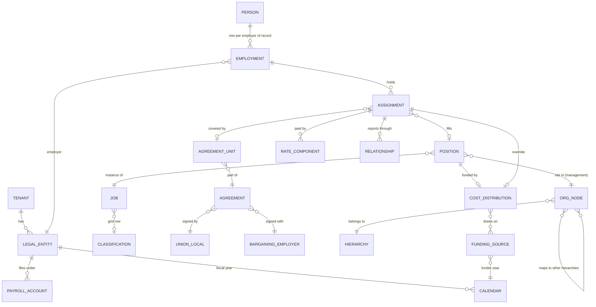

# 17 · Enterprise structures and cross-module integration

Oct 20, 2026 · @Wael

This document defines how CanDo's modules fit together for large and complex employers: cities with dozens of collective agreements and tens of thousands of staff, health authorities, First Nations governments with program and housing entities, and grant-funded non-profits. It covers the organization model, people who hold several jobs, reporting relationships, pay rates, funding and costing, fiscal calendars and the general ledger, going live in the middle of a year, and collective agreements at city scale. It ends with the acceptance scenarios and the changes this requires in the schema and the other documents.

**Precedence.** Where `requirements/01`–`13` or `docs/03`, `05`, `06`, `08` or `09` say something different on these topics, this document wins. §15 lists every place that changes. The schema changes are in `schema/0003_enterprise_structures.sql`, applied as migration 0003 in Step 1, and checked by `tests/schema/schema_0003_smoke.sql`. The agreement rule families in §11.3 are added to `rules/agreements/agreement.schema.json` in Step 7; the field names given here are normative.

**The rule behind everything here: never assume one of anything per person.** A person can have several employments (one per employer of record). Each employment can have several assignments, and each assignment has its own position, agreement, rates, schedule, reporting relationships, funding, leave plans and end date. Code that reads "the employee's manager", "the employee's rate", "the employee's union" or "the employee's cost centre" without naming the assignment and the date is a bug.

---

## 1. What large Canadian employers look like

Findings from current municipal collective agreements and organization charts, checked in October 2026. Each finding becomes a requirement in the sections that follow.

| Pattern | Where it was found | What CanDo must do |
| --- | --- | --- |
| One local, several agreements with one employer | CUPE Local 79 and the City of Toronto have separate agreements for the full-time unit, part-time Unit B, part-time recreation workers and part-time long-term care staff. The full-time agreement also covers an "alternate rate" for employees acting in a Local 79 position from another bargaining unit (Local 416). | Union local → many agreements → many units. Acting and relief rules that cross units (§6, §11) |
| One local, many employers | SCFP 301 (Montreal blue-collar workers) holds the main agreement with the Ville de Montréal, covering about 6,600 workers, and separate agreements with municipalities such as Dorval and Westmount. About 250 blue-collar workers at Parc Jean-Drapeau have their own agreement. | Agreements belong to a bargaining employer, not to the union. One union local is shared reference data across many agreements (§11.1) |
| One corporation, separate agreements by board | CUPE 1004 has one agreement with the City of Vancouver and another with the City as represented by its Board of Parks and Recreation. | A bargaining employer can be an org subtree, not only a legal entity (§3.2, §11.1) |
| Sub-groups with their own rules inside one agreement | Calgary's CUPE Local 38 agreement includes letters of understanding for civilian units of the Calgary Police Service on 10- and 12-hour rotations, which prevail over the main agreement for those employees. A labour board decision moved golf course attendants from Local 37 to Local 38. | Every agreement rule can be scoped to a sub-group; certification changes move positions between units in one effective-dated transaction (§11.2, §11.4) |
| Layoff and seniority units defined by the org chart | Ottawa's part-time recreation agreement lays off in reverse seniority within classification and Branch, and defines a Branch as the structure reporting to the first non-unionized level of management where the layoff happens. | Agreement rules reference computed org groupings, so a reorganization changes seniority units (§3.4) |
| Everything counted in hours | Ottawa part-time staff earn 5 seniority points per 7 hours worked, up to 1,825 a year; probation is 624 paid hours; increments come every 15 months and can be denied for performance with written notice. In Calgary, 1,820 hours count as a year for part-time increments, and 10 or more days of absence can delay an increment. | Generic hour and point counters with calendars, caps and extensions (§6.3, §13) |
| Temporary to permanent by rule | Calgary converts a temporary employee to permanent after 24 months of continuous service in limited-term positions in one business unit, averaging 20 scheduled hours a week over each 6-week period, counting medical and protected leaves; a position is then created for them. | Status conversion engine over rolling windows (§4.5, §11.3) |
| Acting and relief pay | Calgary pays a rate in the higher range at least 5% above the current rate after one full working day of performing the major duties of a higher-rated position, plus an extra step if the employee relieved for two weeks or more in the previous year. Ottawa part-time staff performing most of the duties of a higher-paid job get that job's rate including its premiums. | Acting rules as data, applied per hour or per assignment (§6.2, §11.3) |
| Several jobs inside one unit, and across units | Ottawa part-time staff normally average up to 24 hours a week, may be scheduled up to 32 in listed situations, and those hours may be in more than one job; the employer reports quarterly on people averaging more than 32 hours in any job. A letter of understanding transfers seniority between the inside/outside unit and the part-time unit when someone moves. | Unit hour caps across assignments, compliance reports, reciprocal seniority (§7, §11.3) |
| Cash in lieu of benefits | Ottawa part-time staff receive 12% on their hourly rate in lieu of benefits and statutory holiday pay after probation, 6% after age 65, with older employees grandfathered at 12%. | Cash-in-lieu as an agreement rule that also suppresses holiday pay and benefits eligibility (§7.7) |
| Overtime choices and averaging cycles | Calgary pays double time computed on list pay without shift differentials; the employee chooses cash or lieu time when the work is done; unused lieu time is paid in pay period 3 of the next year. Standard staff work fourteen 7.5-hour days over a three-week cycle. | Averaging cycles that do not line up with bi-weekly pay periods (§7.4); lieu-time elections and payout schedules (§11.3) |
| Obligations that follow the person | Calgary employees promoted out of Local 38 keep their seniority for up to 24 months and keep paying Local 38 dues during that time. | Seniority retention and dues that persist after a transfer out of the unit (§11.3) |
| Retro across many years | Calgary paid retro to employees employed or retired in the retro window, and terminated employees had to apply within 30 days. An Ottawa arbitration award in December 2016 set increases back to January 2012, including a 0.25% step on 19 May 2015, matching the CUPE 503 percentages. | Retro spanning five or more tax years, eligibility by application, pattern settlements applied to several agreements (§11.5, §11.6) |
| Several increases a year | Toronto's 2020–2024 settlement included a 1.5% increase on 1 January 2023 and a further 0.25% on 1 July 2023. | General increases at any date, several per year (§6.4) |
| Grids tied to minimum wage | The bottom steps of Ottawa's part-time grid change on 1 October, the date Ontario's minimum wage changes ($15.50 in October 2022, $16.55 in October 2023). | Grid floors linked to employment standards minimum wage (§6.5) |
| 24/7 public safety | About 3,000 Toronto firefighters work under the Local 3888 agreement, which carries a 24-hour shift schedule; the current agreement expires on 31 December 2026 and unresolved issues go to interest arbitration. | Platoon cycles, averaging, bargaining costing and retro after awards (§7.4, §11) |
| Clusters, divisions, dual reporting | Toronto's City Manager is supported by deputy city managers, each responsible for a service cluster; division heads report through their cluster's deputy. Statutory officers report to Council for statutory purposes and to the City Manager for administrative purposes. | Tenant-defined levels (department, cluster, division, section, sector…) and typed reporting relationships with their own authority (§3, §5) |
| Boroughs as semi-autonomous units | Since 2006 the Ville de Montréal has 19 arrondissements, each with its own operations. | Org nodes that own budgets, approvals and security scopes, at any level (§3.1) |
| Benefits and pensions by agreement | Calgary's Local 38 members belong to the Local Authorities Pension Plan and a municipal employee benefit association; Vancouver's to the Municipal Pension Plan. | Plan membership driven by the agreement and the assignment (§7.8) |

---

## 2. The structural model

| Entity | Meaning | Key rule |
| --- | --- | --- |
| Legal entity | The employer of record: business number, payroll accounts, federal or provincial regulation, fiscal calendar | Statutory hours, overtime and holiday rules aggregate at this level |
| Payroll account | A CRA RP account under the legal entity | CPP, CPP2 and EI maximums, YTD, ROEs and T4s are per person per payroll account |
| Bargaining employer | The party to an agreement: a legal entity, or an org subtree such as a parks board inside the city corporation | Agreements attach here, never to a union |
| Person | One human, one record, for life | Never duplicated across employers or rehires |
| Employment | A person's relationship with one employer of record | Service dates, status, rehire and bridging live here |
| Assignment | One job held by an employment for a period: position, FTE, schedule, pay group, agreement unit, rates, relationships, cost distribution, end date | Every pay line, time line, leave component and approval names an assignment |
| Position | A budgeted seat in the management hierarchy | Exists filled or vacant; carries the default cost distribution |
| Job and classification | What the work is, and the agreement grid row that prices it | A job maps to one classification per agreement version |
| Org node | A unit in one hierarchy, with a tenant-defined level type | A position sits in exactly one management node; other hierarchies are mapped |
| Funding source | Money from a funder or fund with its own rules, budget and calendar | Every distributed dollar names its funding source or the fallback |
| Calendar | Fiscal, funder, agreement, plan, leave or pension year with numbered periods | Every accumulator, budget and report names its calendar |

---

## 3. Organization hierarchies

### 3.1 Level types are defined by the tenant

Cities, health authorities and nations name their levels differently, and the depth varies inside the same organization. CanDo therefore has no fixed list of unit types. Each tenant defines level types per hierarchy:

| Attribute | Meaning |
| --- | --- |
| Code and names (EN/FR) | For example `CORP` Corporation, `CLUSTER` Cluster, `DEPT` Department, `DIV` Division, `SECTION` Section, `SECTOR` Sector, `UNIT` Unit, `CREW` Crew |
| Rank and allowed parents | Rank orders the levels; `allowed_parent_codes` lets a level sit under other levels (for example a Section directly under a Cluster) |
| Owns budget | Nodes at this level hold an approved complement and budget |
| Is cost object | Nodes at this level map to a GL cost centre segment |
| Approval level | Nodes at this level appear in approval chains |
| May be bargaining employer | Nodes at this level can be the employer party to an agreement (for example a parks board) |
| May anchor security scope | Role grants can be scoped to a node of this level and its subtree |
| Authority limits | Delegation of authority by transaction type and amount (§3.5) |

Example configurations:

| Organization | Management levels |
| --- | --- |
| Large city | Corporation → Cluster → Division → Section → Unit → Crew |
| City with boroughs | City → Borough or Central service → Direction → Division → Section |
| Health authority | Authority → Portfolio → Program → Site → Unit |
| First Nation government | Nation → Department → Program → Site, with housing and economic development entities as separate legal entities |
| Non-profit | Organization → Program area → Program → Site |

### 3.2 Several hierarchies at once

Each hierarchy is its own effective-dated tree. Every tenant has exactly one management hierarchy; the others are optional.

| Hierarchy | Purpose | Typical nodes |
| --- | --- | --- |
| Management (required) | Reporting lines, approvals, org chart, positions | Cluster, division, section |
| Financial | GL cost centres and roll-ups | Cost centre groups |
| Funding and program | Grant and program reporting | Program, grant-funded service |
| Geographic or site | Facilities, wards, northern zones | Region, facility |
| Governance | Council, boards, committees, statutory officers | Council, police services board, library board |
| Custom | Anything else the customer reports on | Service lines, wards |

A position sits in one management node. Its node in every other hierarchy comes from the management node's mapping (`core.org_node_mapping`) unless the position has an override with a reason (`core.position_hierarchy_override`). A bargaining employer that is an org subtree is a node flagged `bargaining_employer` in the management or governance hierarchy.

### 3.3 Rules

1. Depth is unlimited; a node's level must be allowed under its parent's level.
2. Creating, renaming, retyping, moving or closing a node is a change set operation with an effective date (`org_unit.*` in `docs/03`).
3. A reorganization is a future-dated set of node versions. Its validation preview lists consequences in every hierarchy: approval chains, cost centres and GL mappings, security scopes, seniority units and computed groupings (§3.4), bargaining employer, open requisitions and workforce plans.
4. Subtree queries use a closure table per hierarchy per valid period (`core.org_closure`), rebuilt from the committed versions after each change set, so "everyone under this cluster on 1 March" is one indexed query.
5. Location, not org node, drives province, time zone and holiday calendar.

### 3.4 Computed groupings for agreements

Agreements define seniority, layoff, bumping, posting and overtime-distribution units in their own words: a Branch, a business unit, a work group, a facility, a classification within a branch. These become grouping rules (`core.org_grouping_rule`) that the agreement rules reference:

| Grouping basis | Meaning |
| --- | --- |
| `level_type` | The ancestor node of a given level type (for example the Section) |
| `first_excluded_head` | The subtree under the first node whose head position is excluded from every bargaining unit (Ottawa's Branch) |
| `subtree` | A named node and everything under it |
| `facility` | The work location |
| `classification_within` | Same classification within one of the groupings above |
| `bargaining_unit` | The whole unit |

When a reorganization changes an employee's grouping, the cascade recomputes affected seniority lists, opens a labour relations task, and never changes the grouping of anyone already in an open layoff, bumping or recall process: those processes keep the grouping that applied when they started.

### 3.5 Delegation of authority

Approval chains come from the management hierarchy and a delegation-of-authority matrix stored as rule data: transaction type × level type × amount limit (for example a Section Manager approves overtime up to a weekly cost, a Division Head approves temporary positions, Council or a board approves changes to the approved complement). Steps that need a council or board resolution are workflow steps with the resolution number as evidence. Acting holders of a position get its authority for the acting period only.

### 3.6 Security scopes

A role grant can be scoped to a node in any hierarchy, an agreement or bargaining unit, a funding source, a location or a payroll account. Examples: a funder-report viewer limited to one funding source; a labour relations officer limited to three agreements; a borough HR team limited to its borough subtree.

---

## 4. Employments and assignments

### 4.1 Employments

One employment per person per employer of record. A person who works for the city and also for the city's police services board or library board (separate employers) has two employments, two sets of statutory maximums and two ROE streams. A rehire reactivates the person and creates or reopens the employment under the bridging rules in force.

### 4.2 Assignment types

| Type | Use |
| --- | --- |
| `regular` | Ongoing job in a position |
| `term` | Fixed end date, often aligned to funding |
| `casual_pool` | On-call or casual work in a pool position |
| `acting` | Temporary appointment to another position; the home assignment is suspended (§4.6) |
| `relief_pool` | Standing eligibility to relieve in listed classifications, paid through time lines |
| `secondment_in`, `secondment_out` | Work for or from another employer, with cost recovery (§8.9) |
| `overlap` | Temporary double-filling of a position, for example training a successor |
| `job_share` | One position, several incumbents, FTE shared |

Each assignment has its own status (`active`, `on_leave`, `suspended_for_acting`, `laid_off`, `ended`), start and end dates and end reason.

### 4.3 Which assignment governs what

Many calculations need to know whether to look at one assignment, the primary one, or all of them combined. This table is configuration (`core.domain_governance`), seeded with these defaults; agreement rules override it where they say so.

| Domain | Default rule | Notes |
| --- | --- | --- |
| CPP, CPP2, EI, YTD | Combined per person per payroll account | Statutory; not configurable |
| Income tax | Combined earnings in one pay result | One TD1 per employment |
| Province of employment | Per assignment, from the establishment the assignment reports to | Earnings for each province are reported on that province's T4 (verify against RC4120 and T4001 at build) |
| Statutory hours, overtime, rest and holiday rules | Combined across all assignments with the same employer | §7.1 |
| Agreement overtime thresholds | Per agreement unit, unless the agreement counts hours across units | §7.1 |
| Overtime rate | The jurisdiction's rule | §7.2; never a blended rate by default |
| Vacation, sick and other leave entitlements | Per leave plan; one plan per agreement or policy | A person in two agreements has two plans; the statutory minimum is checked on the total (§7.5) |
| Benefits eligibility and class | Combined FTE of benefit-eligible assignments with the same employer; class from the governing agreement | §7.7 |
| Pension | Per plan; pensionable earnings combined across assignments in the same plan | §7.8 |
| Seniority | Per agreement and seniority type, from that unit's hours or dates | Reciprocal rules can transfer it (§11.3) |
| Probation and trial periods | Probation per employment; trial periods per assignment | |
| Union dues | Per assignment on that assignment's earnings, plus any dues obligation that continues after a transfer out | |
| Performance review | One review per employment per cycle, owned by the primary assignment's line manager; other line managers contribute | Unit rules can exclude ratings (requirements/07) |
| Learning requirements | The union of every active assignment's requirements | |
| Scheduling conflicts and rest | Checked across all assignments of the person | §7.3 |
| Primary flag | Headcount, directory and default display only | Never used in a pay, leave or benefits calculation |

### 4.4 Ending one assignment while others continue

Ending an assignment is not a termination. `assignment.end` cascades to:

| Area | Effect |
| --- | --- |
| Position | Vacated if no other holder; vacancy and backfill prompt |
| Rates and schedule | Closed at the end date; future shifts for that assignment cancelled |
| Leave | If the assignment's leave plan has no other active assignment, the plan's balances settle by its rules (payout, transfer to another plan where the agreement allows, or forfeiture with notice) |
| Seniority | Retained, frozen or lost per the agreement; a recall right is opened where the end is a layoff |
| Benefits and pension | Eligibility re-evaluated on the remaining combined FTE; coverage or class may change |
| Union dues | Stop for that unit at the end date, unless a continuing obligation applies |
| Funding and GL | Distribution ends; encumbrance released |
| Access | Roles granted through that assignment revoked; others kept |
| ROE | Not issued while insurable earnings continue in the same payroll account; an interruption of earnings is judged per payroll account, by the seven-day rule. Issued if Service Canada asks for one, and issued when the remaining work moves to a different payroll account even without a break (confirm both against Service Canada's ROE guide before Step 13) |
| Statutory notice | Not triggered by the end of one assignment when employment continues, unless the change amounts to a constructive dismissal or a layoff under the agreement; flagged for HR review when hours drop by more than a configurable share |

Ending the last active assignment proposes `employment.terminate` in the same change set and hands over to Module 11.

### 4.5 Term ends, renewals and conversions

Every term assignment has its end date at creation. CanDo prompts the manager and HR at configurable intervals (default 90, 60 and 30 days) to renew, convert or end, and counts renewals so repeated renewals are flagged as possible indefinite employment. The status conversion engine evaluates each assignment's agreement rule (§11.3) nightly over the rolling window it defines, raises a conversion proposal when the threshold is met, and creates the position and the conversion change set for approval.

### 4.6 Acting and relief

Two patterns, chosen by the agreement and the length of the coverage:

1. **Relief on the timesheet.** For hours or days, the time line records the worked position or classification. The rate comes from the acting rule (§6.2), the hours count toward the relief counters (for example two weeks of relief in a year earning an extra step), and the home assignment is unchanged.
2. **Acting assignment.** For longer periods, an `acting` assignment is created in the acting position with its own rate, schedule and cost distribution, and the home assignment moves to `suspended_for_acting` with a `returns_to` link. Ending the acting assignment reactivates the home assignment automatically, with any progression the agreement grants during the acting period.

Acting rules that pay from the first day once a minimum period is reached are evaluated when the minimum is met; earlier days are paid at the acting rate through retro lines in the next run.

### 4.7 Job sharing, overlap and pools

A job-share position has one FTE budget split across incumbents; position control counts the sum. An overlap assignment requires an approved end date. Casual pools are positions with many incumbents and no FTE cap; budget control uses hours.

### 4.8 People who are not employees

Council members, board appointees, volunteer firefighters, election workers and contractors are person types with assignments in their own pay groups (honoraria, per-call pay) or with no pay group. They appear in the org chart and security model only as configured.

---

## 5. Reporting relationships and authority

### 5.1 Relationship types

Each assignment has exactly one **line** relationship on any date: from the position tree in position mode, or explicit in light mode. Other relationships are typed and can be several:

| Type | Example | Default authority |
| --- | --- | --- |
| `line` | Supervisor in the position tree | Approve time, leave and overtime; initiate transactions; lead reviews; see employment fields |
| `administrative` | Officer reporting administratively to a deputy while reporting functionally elsewhere | Approve leave and expenses; no say on professional work |
| `functional` or `professional` | Nurse reporting professionally to a clinical director | Contribute to reviews; set professional standards; see credentials |
| `project` or `program` | Project lead for a grant-funded program | Approve time charged to the project; contribute to reviews |
| `timekeeper` or `scheduler` | Clerk who builds schedules and enters time | Edit schedules and time; no approvals |
| `acting_manager` | Covering for the line manager | Line authority for the acting period |
| `delegate` | Approver while the manager is away | Named authorities, time-boxed |
| `hrbp` | HR business partner | HR authorities in scope |
| `mentor` | Mentor | None beyond notes the mentee shares |

Authorities are a matrix of relationship type × capability, configured per tenant (`core.relationship_type`). A relationship can be narrowed by scope, for example to time charged to one project.

### 5.2 Routing rules

1. A request about one assignment goes to that assignment's approvers.
2. A request that spans assignments (leave covering shifts in two jobs, an availability change) is split into one component per assignment. Each component is approved by its own approver. The employee sees one request with component statuses; if one component is declined, the request is `partially_approved` and the employee chooses to keep or cancel the rest.
3. Person-level data (address, banking, TD1, emergency contacts) goes to HR or payroll, never to line managers.
4. No one approves their own request, a request of someone in their own line chain above them, or a request where they are the requester's subordinate in another assignment. A person who is a supervisor in one assignment and a subordinate in another sees each role separately.
5. Overtime pre-authorization goes to the approver of the assignment in which the overtime will be worked.

### 5.3 Talent and the org chart

Reviewers come from relationship types (§4.3). The org chart shows line relationships by default, dotted lines on request, and a person with several assignments in each of their positions with a marker linking them.

---

## 6. Pay rates

### 6.1 Rate components

Each assignment can carry several effective-dated rate components at once:

| Component | Meaning |
| --- | --- |
| `base` | Grid classification and step, or salary |
| `market_supplement` | Amount or percentage above the grid for recruitment or retention |
| `out_of_schedule` | A separate grade above the evaluated grade set for market reasons, moved step to step, withdrawn only after the notice the agreement requires |
| `red_circle` | A protected rate above the current range, with its protection rule (frozen until the range catches up, general increases only for a period, increases paid as lump sums) |

Premiums, allowances and cash in lieu are not rate components; they come from agreement rules.

### 6.2 Resolving the rate for an hour

For each time line, the engine resolves the rate in this order and records the path:

1. **Worked classification on the line** (relief): the acting rule of the agreement covering the worked position decides the rate (for example the step in the higher range at least a set percentage above the current rate, or the higher job's rate including its premiums), once the rule's minimum duration is met.
2. **Acting assignment:** its own rate components.
3. **Home assignment:** base plus supplements, or the protected rate where `red_circle` applies.
4. **Minimum wage floor** for the location and date, from the employment standards edition.
5. The time engine then applies multipliers and premiums (`docs/08` §5).

### 6.3 Progression

Grid progression is evaluated per assignment from counters (§13): months of service, hours paid in the classification, or anniversaries, with the agreement's hour equivalents for part-time staff, extensions for long absences, performance holds that require written notice before the due date, new-hire rates below step 1, and credit for relief time in a higher classification. Where an agreement pools hours across assignments in the same classification, the counter's scope says so.

### 6.4 General increases

An agreement version can carry any number of general increases on any dates, each with its population (classifications, units, out-of-schedule rates, red-circled employees paid as lump sums). Increases apply to grids as new grid versions; pay rates follow by `compensation.set_rate` with source `agreement_grid`, previewed before activation.

### 6.5 Minimum wage linkage

A grid step can be defined relative to the minimum wage of a jurisdiction (equal to it, or a margin above it). When a new employment standards edition changes the minimum wage, CanDo proposes the new grid version and the rate changes for the same effective date, with the agreement article cited.

---

## 7. Hours, overtime, leave and benefits across assignments

### 7.1 Aggregation

- **Statute:** hours for employment standards thresholds (daily and weekly overtime, maximum hours, rest periods) aggregate across all assignments with the same employer (legal entity), in chronological order of work.
- **Agreements:** an agreement's thresholds count the hours worked in its own unit, unless its `hours_counting.cross_unit` rule says otherwise.
- The time engine computes both and pays the greater right per hour, as in `docs/08` §2.

### 7.2 Overtime allocation and rate

Overtime hours belong to the assignment in which the threshold was crossed and every later hour that week. The rate for an overtime hour comes from the jurisdiction's rule, held in the employment standards file as `overtime_rate_basis_multi_rate`:

| Value | Meaning | Where |
| --- | --- | --- |
| `rate_for_work_performed` | 1.5 × the regular rate for the work performed in that hour | Ontario, ESA s. 22(1.1) |
| `weighted_average` | 1.5 × the weighted average of the week's regular rates | Only where a jurisdiction requires it |
| `verify_at_load` | Unknown until checked | Every other jurisdiction until employment law review |

Ontario's exemption test for mixed work (overtime is owed for the whole week if at least half the hours are in work covered by overtime) is a separate employment standards rule. The statements in `requirements/03` and `docs/09` that payroll uses a blended rate are withdrawn.

### 7.3 Scheduling across assignments

Schedules are validated against all of a person's assignments: overlapping shifts, minimum rest between shifts, maximum daily and weekly hours, and unit hour caps (for example a part-time unit's weekly average). A conflict shows both assignments and both schedulers.

### 7.4 Averaging and platoon cycles

Some schedules settle overtime over a cycle longer than the pay period: a three-week cycle of fourteen 7.5-hour days, a 28-day rotation averaging 40 hours, a four-platoon fire schedule. Each such schedule has an `averaging_cycle` (length and anchor date). Within an open cycle, hours that are certainly overtime (daily thresholds) are paid in the period worked; the rest are paid at straight time and marked provisional on the time line. When the cycle closes, the time engine settles the cycle, and any overtime owed is paid as retro lines dated to the original work days. Cycle boundaries never move with the pay calendar.

### 7.5 Leave across assignments

- Leave entitlements live in plans owned by an agreement or a policy. The leave ledger is keyed by employment and plan (`plan_code`), so a person covered by two agreements has two vacation balances.
- A leave request names the assignments it covers. One assignment can be on leave while another is active (for example a protected leave from a full-time job while keeping a casual job); the system checks the leave's rules and, for disability-related absences, prompts the accommodation and benefits checks in Modules 13 and 05.
- The statutory vacation minimum is checked on the total across plans with the same employer; a shortfall creates a top-up entitlement in the plan of the primary assignment.

### 7.6 Statutory holidays with several jobs

The statutory holiday pay formula is computed at the employer level on all wages from that employer, unless the jurisdiction's rule says otherwise (`verify_at_load`). Agreement holiday pay is computed per unit. The person receives the greater right per holiday per employer, and the amount is allocated back to assignments in proportion to the wages used in the formula, so costing and dues stay correct. Cash in lieu of holiday pay (§7.7) counts toward the agreement amount.

### 7.7 Benefits eligibility, classes and cash in lieu

- Eligibility uses the combined FTE of benefit-eligible assignments with the same employer, unless the governing agreement says per assignment.
- When assignments are in different agreements, the benefit class comes from the governing agreement, which HR chooses for that person and records why; CanDo makes no automatic choice and stops with `GOVERNING_AGREEMENT_NOT_SET` until HR does (owner's decision, 28 October 2026, `docs/26` §5.1, FB-023).
- An assignment whose agreement pays cash in lieu of benefits is excluded from the FTE count for those plans, and its percentage is paid on that assignment's eligible hours.

### 7.8 Pensions

Plan membership follows each assignment's agreement and the plan's rules (mandatory for full-time, optional or hours-based for part-time and casual). Pensionable earnings combine across assignments in the same plan; contributions are split back to assignments for costing. A person can be in a plan for one assignment and outside it for another.

---

## 8. Funding and costing

### 8.1 Entities

| Entity | Content |
| --- | --- |
| Funding source | Funder, funding agreement reference, legal entity, funder calendar, valid period, status, eligible cost categories, administration cap, whether statutory burden and benefits are eligible, cap behaviour, post-close policy, successor, fallback segments, accounting basis (accrual or cash) |
| Funding budget | Amount per cost category per funder period |
| Cost distribution | Effective-dated lines on a position, an assignment or an org node: funding source (optional), GL segments, percentage or fixed amount per period, eligible categories, priority |
| GL segments | Tenant-defined (fund, cost centre, program, project, activity, location, funder), each with its source |

`core.position_funding` from migration 0001 is read only by the data migration into `finance.cost_distribution`; new code writes and reads cost distributions.

### 8.2 Where each dollar goes

Every pay result line is distributed when it is calculated, by the first source that applies on the line's work date:

1. Explicit allocation on the time line or one-time item (project, work order, grant)
2. Assignment cost distribution
3. Position cost distribution
4. Org node default from the financial hierarchy
5. Legal entity suspense account, with a task to fix the gap

The distribution is stored per line in `payroll.pay_result_line_distribution` with the source that produced it.

### 8.3 Validation on every distributed amount

| Check | Rule |
| --- | --- |
| Total | Percentage lines for a target add to 100% on every date, or the remainder line is named |
| Active | The funding source is active on the work date |
| Eligible | The line's cost category (salary, overtime, premiums, statutory burden, employer benefits, employer pension, vacation accrual, severance, retro, training) is eligible for the source |
| Cap | The source's budget for the category and funder period is not exceeded |

When a check fails, the source's `cap_behaviour` decides: `hard_stop` blocks approval of the time or the run, `spill_next_line` moves the excess to the next line by priority, `spill_fallback` moves it to the fallback segments, `warn_only` posts and warns. Ineligible categories always go to the fallback.

### 8.4 Employer burden

Employer CPP, CPP2, EI, employer health tax and levies, workers' compensation, benefits and pension are distributed in proportion to the eligible earnings they arise from, unless the funding source excludes burden, in which case the burden goes to the fallback. Employer health tax and levies with annual thresholds are allocated by share of remuneration, with the exemption allocated by a configured method (pro rata, or to the operating fund first).

### 8.5 Leave and liability costing

For funders on an accrual basis, vacation and banked time are costed when earned, to the funding in force when they are earned, and post to a liability account. When the time is taken or paid out, the liability is relieved; the current funder is not charged again. For funders on a cash basis, the cost is charged when paid, to the funding in force on the payment's work date. Severance and termination pay follow the source's eligible categories.

### 8.6 Funding ends

Alerts go to the position owner and finance 90, 60 and 30 days before a source ends (configurable). On the end date the source's lines stop. Positions left without funding fall to the next rule in §8.2 and raise a task; term assignments aligned to the funding are proposed for ending or renewal (§4.5).

### 8.7 Retro, corrections and closed grants

Retro and corrections are charged to the funding in force on the original work date. If that source is closed or its funder period is final, the source's `post_close_policy` decides: the successor source, the fallback, or suspense, and a funder adjustment report lists the amounts.

### 8.8 Rounding

Each pay line is distributed to the cent by largest remainder, in funding line order, so distributed amounts always add up exactly to the line.

### 8.9 Commitments and forecast

For every filled position and every budgeted vacant position, CanDo projects salary and burden to the end of the fiscal year and to the end of each funding source, using current rates, scheduled increases and the agreement's progression. The projection is the commitment shown against budgets: requisition approvals check it (Module 02), funders see burn rates, and finance sees the forecast (Module 09).

### 8.10 Secondments, loans and shared services

When an employee paid by one legal entity works for another (a secondment, a loan to another municipality, shared services across boards), the paying entity keeps payroll and slips, and CanDo produces an intercompany recovery journal by the arrangement's basis (cost, cost plus markup, or fixed fee).

### 8.11 Funder reporting

Funder reports run on the funder's calendar: eligible costs by category, position and person, hours, with timesheet evidence, adjustments from §8.7 and remaining budget.

---

## 9. Fiscal calendars and the general ledger

### 9.1 Calendars

Every period-based number names its calendar. The calendars CanDo keeps:

| Calendar | Owner | Drives |
| --- | --- | --- |
| Tax year | Fixed: calendar year of the pay date | Statutory editions, YTD, slips |
| Fiscal year | Legal entity: any start month, 12 or 13 periods, or 4-4-5 | GL, budgets, commitments |
| Funder year | Funding source | Funder budgets and reports |
| Agreement year | Agreement | Wage increase dates, vacation years, lieu payout dates |
| Benefit plan year | Benefit plan | Spending accounts, deductibles |
| Leave year | Leave plan | Accrual resets, carry-over, expiry |
| Pension year | Pension plan | Contribution limits, member data |

### 9.2 Two periods on every GL line

Every GL line carries the **work period** (the fiscal period of the work date, which recognizes the expense) and the **posting period** (the open accounting period it is booked in). If the work period is open, they are the same. If it is closed, the line posts to the first open period, keeps a reference to its work period, and uses the GL mapping in force on the work date or the posting date as the legal entity chooses.

### 9.3 Period-end accrual run

At each fiscal period end, an accrual run uses the simulation engine to compute earnings and burden for days worked but not yet paid: approved and submitted time for hourly staff, scheduled hours for salaried staff, and provisional averaging-cycle hours. It posts an accrual journal with automatic reversal on the first day of the next period. The same run revalues liabilities (vacation, banked time, capped sick payouts, retro reserve) and posts the change.

### 9.4 Fiscal year end and unsettled agreements

At fiscal year end, finance hard-closes the year. Retro and corrections for a closed year post to the current year, to prior-year adjustment accounts where the legal entity chooses. For each agreement that has expired and is still being bargained, labour relations costing (Module 13) produces an estimate of the retro owed to year end; finance can post it as a retro reserve accrual, which the retro run later relieves.

### 9.5 Mapping changes

GL mapping rules (pay code and segments to accounts) are effective-dated versions. A chart of accounts change in the middle of a year is a new mapping version; a preview shows which lines map differently. Every journal records the mapping version it used.

### 9.6 Other journals

Payroll clearing and bank reconciliation, remittance liabilities by payee, intercompany recoveries (§8.10) and opening balances at go-live (§10) are journals of their own kinds, each traceable to the runs and balances that produced them.

---

## 10. Going live in the middle of a year

Customers will rarely start on 1 January. A mid-year go-live is a project with its own checklist, data and tests.

| Step | What CanDo needs | Why |
| --- | --- | --- |
| 1. Cut-over pay date | The first pay date CanDo pays; the legacy system pays everything before | One source of truth per pay date |
| 2. External pay coverage | For each employment, the work days the legacy system has already paid (`payroll.external_pay_coverage`) | The first CanDo period may straddle the cut-over; covered days are never paid twice |
| 3. Tax-year YTD | Per person × payroll account × province × code: every statutory bucket, every T4 box, pensionable and insurable earnings, pension adjustment | CPP, CPP2 and EI maximums, and one T4 per payroll account and province for the year (default) |
| 4. Period history for ROEs | Insurable earnings and hours by pay period, for the number of periods an ROE requires | An ROE issued after go-live covers periods paid by the legacy system |
| 5. Period history for retro | Pay results by pay code and period back to the earliest date a retro could reach: the expiry of every agreement in bargaining, any pending `retro_from`, open grievance and pay equity windows | Retro after go-live compares CanDo's "should have been paid" with migrated "was paid" |
| 6. Look-back history | Wages for holiday-pay look-backs, open averaging cycles, progression hours and months by classification, seniority hours and points, conversion windows, probation hours, relief days | Rules that look back past the cut-over must have their inputs |
| 7. Balances | Leave by plan, banked time, sick credits, arrears, garnishment balances, loans | Ledgers open with verified balances |
| 8. GL opening | Liabilities (vacation, banked time, capped sick payouts, retro reserve, payroll clearing) as subledger opening balances matching the GL; the last legacy month-end accrual, which CanDo reverses in its first period unless the legacy system does | CanDo never reposts history; its first journals post only the change |
| 9. Funding spent to date | Spent to date per funding source, category and funder period | Caps and burn rates are right from day one |
| 10. Parallel runs | At least two full cycles compared to the cent, and GL compared by account | Go-live gate in requirements/03 |

The importers for steps 2 to 9 use validated templates (CSV or Excel), produce a reconciliation report against the legacy register, and load through change sets with source `import`. Migrated history is stored in `payroll.migrated_pay_history` and `payroll.opening_balance` and is read-only after sign-off.

---

## 11. Collective agreements at city scale

### 11.1 Library structure

Union → local (`core.union_local`, shared by every agreement it signs) → agreement (with one bargaining employer: a legal entity or a flagged org node) → bargaining units → scoped groups (letters of understanding, schedules, side agreements) → versions → rules.

### 11.2 Scoped rules

Every rule in an agreement version can carry `applies_to` with selectors: classifications, position groups, org nodes or subtrees, locations, schedule types, employment types and statuses, hour bands, age bands. The most specific matching scope wins; where the agreement says a letter prevails, its rules carry `precedence: "prevails"`. The verifier rejects overlapping scopes that have no precedence (`AMBIGUOUS_SCOPE`). `rules.resolve()` takes the assignment and date, finds the matching scopes, and records the scope in the rule path.

### 11.3 Rule families to add to `agreement.schema.json`

Every family has `cite` and `provenance`, and every rule can have `applies_to`.

| Family | Fields | Example it must express |
| --- | --- | --- |
| `acting_pay` | `trigger` (`full_day`, `majority_of_duties`, `hours_min`, `consecutive_days_min`), `rate_method` (`step_at_least_percent_above`, `rate_of_position_incl_premiums`, `fixed_premium`, `percent_premium`), `percent`, `paid_from` (`trigger_met`, `first_day`), `credit` (counter and amount toward the higher classification) | Calgary 112: one full day, step at least 5% higher; extra step after two weeks of relief in the previous year |
| `status_conversion` | `from_types`, `to_type`, `window` (months or hours), `measured_over` (rolling weeks), `average_hours_min`, `same_grouping`, `counts_leaves` (list), `creates_position` | Calgary 109.04: 24 months, 20 hours average over each 6 weeks, medical and protected leaves count |
| `seniority` (extended) | `accrual: points` with `points_per_hours` and `annual_cap`; `break_in_service_months`; `unpaid_leave_adjustment_days`; `retain_after_transfer_out_months`; `reciprocal` (other unit, `transfer_on`, conditions) | Ottawa: 5 points per 7 hours, 1,825 a year; reciprocal transfer with the inside/outside unit |
| `progression` (on `wage_grid`) | `hour_equivalents` (for example 1,820 hours = 12 months), `absence_extension_days`, `performance_hold` with `notice_days_min` and `max`, `new_hire_rates`, `relief_credit` | Calgary 313; Ottawa 17.3–17.5 |
| `rate_protection` | `red_circle` (`freeze`, `general_increases_for_months`, `lump_sum`), `out_of_schedule` (`notice_months_before_reduction`) | Calgary 105.01.05, 105.04.04–05 |
| `cash_in_lieu` | `percent`, `replaces` (benefits, holiday pay), `after` (probation or months), `age_bands`, `grandfathered` | Ottawa 25.1–25.2 |
| `vacation` (extended) | `pay_method` (`time`, `percent_of_gross_each_period`), `week_hours` (35 or 40), `banking` (per year, cap), `termination_percent` by tier | Ottawa 6.1; Calgary 201–202 |
| `lieu_time` | `election_at_time_of_work`, `payout` (date rule such as `pay_period_3_next_year`), `carryover_months` | Calgary 308.03 |
| `averaging_cycle` | `length_days`, `anchor`, `target_hours` | Calgary 301.02 three-week cycle; 28-day police civilian rotations |
| `work_offering` | ordered tiers (same title same facility, same facility, posting), `returning_staff_first_refusal`, `distribution` | Ottawa 10.2–10.3 |
| `unit_hours_cap` | `average_weekly_max`, `exceptions` with their own max, `report` frequency and threshold | Ottawa LOU 2 |
| `layoff_recall` (extended) | `grouping` (§3.4), `bumping_path` (ordered groupings and `equal_or_lower`), `recall_months`, `notice_weeks` | Ottawa 11.3 |
| `union_dues` (extended) | `continues_after_transfer_out_months` | Calgary 110.08 |
| `retro` (extended) | `eligible_population` adds `terminated_on_application` with `application_days`, and `retirees` | Calgary 207.01 |
| `discipline` | `sunset_months`, `extended_by_absence_days_over` | Calgary 116.01 |
| `holiday_pay` (part-time) | `average_daily_wage_weeks`, `lieu_day_during` (leave types) | Calgary 203.02–203.03 |
| `plans` | `pension_plan`, `benefit_association` | LAPP, MPP, OMERS |
| `service_pay` | tiers by years, amount per month, `paid` date rule | Calgary 205 |
| `grid_floor` | `minimum_wage_jurisdiction`, `margin` | Ottawa part-time grid |

The completeness guard in `docs/08` §5 extends to these families: an assignment that meets two acting rules, two conversion rules or two seniority accruals without precedence raises `UNRESOLVED_INTERACTION`.

### 11.4 Certification and unit changes

When a labour board moves positions from one unit to another, or a new unit is certified, the change is one effective-dated `agreement.transfer_positions` change set: positions get the new unit; assignments move with them; grid mapping proposes the new classification and step (confirmation required); seniority converts by the decision's terms; dues switch on the effective date; leave plans transfer or settle; open grievances stay with the old agreement version.

### 11.5 Pattern settlements

A settlement template (increases, dates, lump sums) can be applied to several agreements at once, producing one draft version per agreement. Each version is still verified and activated on its own, with its own retro.

### 11.6 Retro across many years

A version whose `retro_from` reaches back several tax years creates retro requests for every finalized period since then, in batches (`docs/06` §6). Eligibility follows the extended `retro` rule: employees who left must apply within the window, and the application is a task with a deadline. Prior-year amounts are paid and taxed in the current year with T1198 where it qualifies, and pension and ROE corrections follow. GL follows §8.7 and §9.4.

### 11.7 Essential services and strikes

Essential positions and minimum staffing per agreement are stored; during a strike, scheduling checks them, payroll stops pay for striking assignments by date range, and benefits continuation follows the agreement or the employer's decision.

---

## 12. Cross-module event map

What each module does when something happens. Every row is a cascade rule (`docs/05` §3) or an event subscriber.

**12.1 A second assignment is added (same employer, different agreement)**

| Module | Effect |
| --- | --- |
| Core HR | New assignment in the second position; domain governance recalculated; primary flag unchanged unless chosen |
| Time and leave | Second schedule; cross-assignment conflict check; a second leave plan opens with its own accruals |
| Payroll | Same pay subject; earnings combined for tax and maximums; dues per agreement |
| Benefits and pension | Combined FTE re-evaluated; class from the governing agreement; plan membership for the new assignment |
| Funding and GL | New distribution from the position; commitment added |
| Labour relations | Seniority opens in the second unit; probation or trial period per assignment |
| Talent | Second line manager becomes a review contributor; learning requirements merged |

**12.2 One assignment ends while another continues** — §4.4.

**12.3 Relief in a higher classification for three days**

| Module | Effect |
| --- | --- |
| Time | Lines record the worked classification; relief counter credited |
| Payroll | Acting rule applied once its trigger is met; earlier days paid by retro lines if the rule pays from day one |
| Funding | Lines distributed by the worked position's funding if the rule says so, otherwise the home assignment's |
| Labour relations | Relief days count toward the extra-step rule |

**12.4 Reorganization moves a section to another division**

| Module | Effect |
| --- | --- |
| Core HR | Future-dated node versions; closure tables rebuilt at commit |
| Workflow | Approval chains and delegation limits recomputed from the effective date; open approvals rerouted |
| Security | Scopes recomputed |
| Funding and GL | Mapped cost centres change from the effective date; commitments move |
| Labour relations | Computed groupings recomputed; seniority lists republished with a challenge period; open layoff and recall processes keep their old groupings |
| Analytics | History stays on the old structure; "as of" reports show each |

**12.5 A funding source ends or is cut**

| Module | Effect |
| --- | --- |
| Funding | Alerts before the end date; lines stop; fallback applies |
| Core HR | Term assignments aligned to the source proposed for ending or renewal |
| Recruitment | Requisitions on affected positions blocked until funded |
| Offboarding | Layoff process proposed where positions are eliminated |
| Payroll and GL | Retro after closure follows `post_close_policy` |

**12.6 An agreement is ratified with retro across fiscal and tax years**

| Module | Effect |
| --- | --- |
| Agreement library | New version verified and activated; grids and rules hashed |
| Core HR | Rate changes for every covered assignment, previewed |
| Payroll | Retro requests per finalized period since `retro_from`; paid as non-periodic; T1198 where it qualifies |
| Time | Overtime and premiums recalculated for the retro periods |
| Pension | Contribution differences to the plan file; pension adjustments amended |
| ROE | Amended ROEs where insurable earnings changed |
| Funding and GL | Charged per §8.7; posted per §9.2 and §9.4 |
| Benefits | Salary-based coverage (life, LTD) recalculated with premium differences |

**12.7 Leave in one assignment, work continues in another**

| Module | Effect |
| --- | --- |
| Time and leave | Leave component on the named assignment; schedules there cancelled |
| Benefits | Disability checks when the reason requires; continuation rules for the leave assignment |
| Payroll | Top-ups for that assignment only; no ROE while insurable earnings continue in the payroll account |
| Compliance | Accommodation prompts when the absence is disability-related |

**12.8 Transfer to another employer of record (city to police board)**

| Module | Effect |
| --- | --- |
| Core HR | Assignment ends in the first employment; assignment created in the second employment (created if needed) |
| Payroll | New payroll account and YTD; ROE issued for the first account even with no break |
| Seniority and service | Carried only where an inter-employer agreement or policy says so |
| Benefits and pension | Plan transfers where both employers are in the same plan |

**12.9 Temporary-to-permanent threshold reached**

| Module | Effect |
| --- | --- |
| Core HR | Conversion proposal; position created; assignment type changes |
| Benefits | Eligibility opens with any waiting period |
| Labour relations | Seniority status and lists updated; union notified |

**12.10 Minimum wage changes** — new employment standards edition; grid floors proposed (§6.5); rates below the floor flagged before the effective date.

**12.11 Fiscal period close** — accrual run (§9.3), liability revaluation, posting period locked; later lines post to the next open period.

**12.12 Mid-year go-live** — §10.

---

## 13. Counters and scale

**Counters.** Seniority points, progression hours, conversion windows, probation hours, relief days, acting days and service-pay months are ledgers (`core.counter_ledger`), like leave: balance as of any date equals the sum of entries, never a stored number. Each entry names its scope (agreement, seniority type, classification, grouping) and calendar period. Corrections supersede entries in system time. The existing `core.seniority_ledger` remains for seniority lists.

**Scale targets** (in addition to `docs/02`):

| Area | Target |
| --- | --- |
| Org | 20,000 nodes across 6 hierarchies; subtree query under 50 ms from the closure table |
| Agreements | 200 agreements and 2,000 scoped rules per tenant; `rules.resolve()` cached by version hash and scope |
| Mass changes | A reorganization of 5,000 assignments validated with full consequences in under 2 minutes |
| Retro | 8,000 employees over 72 periods in one retro batch, processed in parallel with progress |
| Distribution | Pay result lines distributed in the bucket transaction; GL journals aggregated by segment and period |
| Seniority lists | Recomputed incrementally from counter entries after each commit; full rebuild nightly |

---

## 14. Acceptance scenarios

The worked case: **Jordan** works for the City of Example (Ontario) and its public library board, which is a separate employer.

- **A1** Program Coordinator, permanent part-time, 0.6 FTE, inside/outside agreement (IO), Community Services cluster › Recreation division › North section; funded 70% by the operating fund and 30% by a provincial youth grant ending 31 March 2027 (funder year April to March).
- **A2** Lifeguard-Instructor, casual, part-time recreation agreement (PT): seniority points, 12% cash in lieu of benefits and holiday pay.
- **A3** Library Assistant, casual, library board employment, its own payroll account.

| ID | Scenario | Expected | Step |
| --- | --- | --- | --- |
| ENT-001 | Tenant defines Corporation → Cluster → Division → Section → Unit and places a Section directly under a Cluster | Allowed only if `allowed_parent_codes` permits; otherwise `LEVEL_NOT_ALLOWED` | 5 |
| ENT-002 | Same tenant adds a financial hierarchy; a position overrides its mapped cost centre | Override requires a reason; GL lines use the override from its effective date | 5 |
| ENT-003 | Subtree query for the Recreation division as of a past and a future date | Returns the nodes valid on each date from the closure table | 5 |
| ENT-004 | Reorganization moves North section to another division, effective in 30 days | Preview lists changed approval chains, cost centres, security scopes and seniority groupings; nothing changes before the date | 6 |
| ENT-005 | Ottawa-style Branch grouping (first excluded head) with a layoff already open | Reorg recomputes groupings for new processes; the open layoff keeps its original grouping | 18 |
| ENT-006 | Jordan's leave request covers shifts in A1 and A2 | Two components to two approvers; one declined → `partially_approved` | 11 |
| ENT-007 | Jordan's A1 manager is also Jordan's subordinate in another assignment | That manager cannot approve Jordan's A1 request; routing goes to the next approver | 4 |
| ENT-008 | Week with 30 hours in A1 (Monday to Wednesday) and then 16 hours in A2 (Thursday to Saturday) under Ontario rules | 2 hours of statutory overtime, in A2 (where 44 was crossed), at 1.5 × the A2 rate; agreement thresholds checked per unit and the greater right paid | 11 |
| ENT-009 | The same week in a jurisdiction marked `verify_at_load` for multi-rate overtime | Timesheet approval stops with `RULE_NOT_VERIFIED`; nothing is guessed | 11 |
| ENT-010 | Jordan relieves in a higher classification for three days under an acting rule that pays from day one after one full day | Day 1 at acting rate once the trigger is met; relief counter credited three days | 11 |
| ENT-011 | Acting assignment for 10 weeks | Home assignment `suspended_for_acting`; acting assignment paid and costed on its own; home reactivates on the end date | 5 |
| ENT-012 | A1 grant line ends 31 March 2027 with `cap_behaviour = spill_fallback` | April A1 earnings distributed 100% to the operating fund; alerts were raised at 90, 60 and 30 days | 12 |
| ENT-013 | A1 grant budget for salaries reaches its cap mid-period | Excess salary moves to the fallback; burden follows earnings only where the grant allows burden | 12 |
| ENT-014 | Retro in June 2027 for A1 work in February 2027, grant closed | Retro charged per `post_close_policy`; funder adjustment report lists it | 10 |
| ENT-015 | Every distributed line | Distribution amounts add up exactly to the line amount (largest remainder) | 9 |
| ENT-016 | A1 ends on 31 March 2027; A2 continues with earnings the following week | No ROE; IO leave plan settles per its rules; benefits re-evaluated; position vacated | 16 |
| ENT-017 | A3 ends; Jordan has no other library board assignment | ROE issued for the library board payroll account; city employment unaffected | 16 |
| ENT-018 | CPP and EI for Jordan in the same month | City and library board deduct and track maximums separately; A1 and A2 combine | 9 |
| ENT-019 | Vacation balances | Two plans (IO and PT); statutory minimum checked on the total | 11 |
| ENT-020 | Ontario public holiday | Statutory formula on all city wages; agreement amounts per unit; PT cash in lieu counts; greater right per employer, allocated back by wage share | 11 |
| ENT-021 | Calgary-style temporary employee reaches 24 months in one business unit averaging 20 hours over every 6-week window, with a parental leave inside the window | Conversion proposed; leave counted; position created on approval | 14 |
| ENT-022 | Ottawa-style part-time employee works 700 hours in a year | 500 seniority points; cap of 1,825 enforced across the year | 7 |
| ENT-023 | Three-week averaging cycle crossing two bi-weekly pay periods with 4 extra hours in week 1 | Week 1 extra hours provisional at straight time; cycle settlement pays the overtime premium dated to the original days | 11 |
| ENT-024 | Agreement ratified with `retro_from` 4 years earlier; one former employee applies on day 25, another on day 40 of a 30-day window | Retro paid to the first, not the second; prior-year amounts taxed in the current year | 10 |
| ENT-025 | Labour board moves 40 positions between units | One change set; grid mapping confirmed; seniority converted; dues switch on the date; open grievances unchanged | 18 |
| ENT-026 | Fiscal period end with 4 unpaid working days | Accrual journal posted and auto-reversed; true-up when the pay posts | 12 |
| ENT-027 | Correction for a closed fiscal period | Posts to the first open period with the work period reference | 12 |
| ENT-028 | Mid-year go-live on a pay date whose work period starts 3 days before cut-over | Covered days excluded; YTD, period history and opening liabilities loaded and reconciled to the cent | 9 and 13 |
| ENT-029 | Retro after go-live into a pre-go-live period | "Was paid" read from migrated history; difference paid by CanDo | 10 |
| ENT-030 | Minimum wage edition changes the floor above a grid step linked to it | Grid version and rate changes proposed for the same effective date | 7 |
| ENT-031 | Transfer from the city to the police services board (separate employer) | New employment and payroll account; ROE for the city account; seniority carried only if configured | 16 |
| ENT-032 | Funder-report viewer scoped to the youth grant | Sees only costs distributed to that source; no other pay data | 3 |

---

## 15. Changes to other documents

| Document | Change |
| --- | --- |
| `docs/03` §2 example and §5 | OrgUnit gains `hierarchy_id`, `level_type_code` and `bargaining_employer`; unit type is no longer a fixed list. Assignment gains `status`, `end_reason`, `returns_to_assignment_id` and the types in §4.2. PayRate gains `component` (§6.1). |
| `docs/03` §4 operations | Add `hierarchy.*`, `org_level_type.*`, `org_node_mapping.set`, `position.override_hierarchy`, `relationship.add` and `relationship.end`, `assignment.suspend_for_acting`, `cost_distribution.set`, `funding_source.*`, `counter.adjust`, `agreement.transfer_positions`, `go_live.load_*` |
| `docs/03` §6 validation | Add: level allowed under parent; cost distribution totals and active sources; cross-assignment schedule conflicts; self-approval across assignments (§5.2) |
| `docs/05` §3 cascade matrix | Add rows for §4.4, §12.3–12.10 |
| `docs/06` §3 step 5 | Lines are distributed by §8.2 into `pay_result_line_distribution`, with work and funder periods |
| `docs/06` §5 | Fiscal handling follows §9.2–9.4; accrual run §9.3 |
| `docs/06` §6 | Retro charging follows §8.7; "was paid" may come from migrated history (§10) |
| `docs/08` §3 | `rules.resolve()` matches `applies_to` scopes and returns the scope in the rule path |
| `docs/08` §4 | Library structure per §11.1; pattern settlements §11.5; unit transfers §11.4 |
| `docs/09` §1 "Multiple assignments" | Replace with §7.1–7.4 |
| `docs/09` §3 | Ledger keyed by employment and plan (§7.5) |
| `requirements/01` Organization structure | Replace the fixed level table with §3.1–3.2; reporting lines per §5 |
| `requirements/01` Multiple assignments | Add §4.3 and §4.4 |
| `requirements/03` Multi-position row | Replace "blended (weighted average) overtime rate across positions" with "overtime rate per the jurisdiction's rule (§7.2)" |
| `requirements/05` Eligibility | Combined FTE and governing agreement per §7.7; cash in lieu excludes an assignment |
| `requirements/06` Leave types and requests | Leave plans per agreement; requests name assignments; components per §5.2 |
| `requirements/09` Headcount and budget | Commitments and forecast per §8.9 |
| `requirements/11` Separation types | Assignment end versus employment termination per §4.4; ROE per payroll account |
| `requirements/13` Agreement library | Structure, scopes, families and unit transfers per §11 |
| `AGENTS.md` | Reading order and rules 19–22 |
| `schema/0003_enterprise_structures.sql` | New; applied in Step 1 as migration 0003 |
| `tests/schema/schema_0003_smoke.sql` | New; runs in CI after migration 0003 (RLS on every new table, level types, calendar and distribution overlaps, acting assignments, leave components, rate components, go-live coverage, accrual journals, tenant isolation) |

---

## 16. Open questions

| # | Question | Default until decided |
| --- | --- | --- |
| E1 | ~~At a mid-year go-live, who issues the T4?~~ **Decided (27 Oct 2026):** CanDo, one T4 per employee for the whole year, combining the imported YTD (`docs/24` §3.4) | — |
| E2 | ~~Default cap behaviour for new funding sources~~ **Decided (27 Oct 2026):** the fallback fund, alerts at 90, 60 and 30 days; each source can differ (`docs/24` §8.1) | — |
| E3 | ~~Default benefit-class rule for people in two agreements~~ **Decided (28 Oct 2026):** HR chooses the governing agreement for each person, with a reason (`docs/26` §5.1) | — |
| E4 | ~~Post GL directly to the ERP, or produce journals?~~ **Decided (27 Oct 2026):** journal files in each accounting system's import format; direct connections later (`docs/24` §8.3) | — |
| E5 | Provincial tax for one pay subject with assignments reporting to establishments in two provinces | Split by province of employment per assignment; verify with T4001 and RC4120 before Step 9 |

---

## Sources

- City of Toronto, CUPE Local 79 full-time collective agreement 2020–2024 (index of alternate rate, temporary employee and capped sick pay provisions): https://scfp.ca/collective-agreement/29362
- City of Toronto, CUPE Local 79 part-time recreation and long-term care unit agreements: https://www.toronto.ca/wp-content/uploads/2025/11/96bf-L79-Rec-Unit-2012-2015-CA.pdf and https://www.toronto.ca/wp-content/uploads/2025/11/972c-L79-LTCHS-PT-Unit-2012-2015-CA.pdf
- City of Toronto, results of bargaining with CUPE Local 79 (2020–2024 increases): https://www.toronto.ca/legdocs/mmis/2021/cc/bgrd/backgroundfile-165298.pdf
- City of Toronto, administrative structure (September 2025): https://www.toronto.ca/wp-content/uploads/2017/11/91e9-city-toronto-organizational-chart.pdf
- Municipal government of Toronto (clusters, statutory officers): https://en.wikipedia.org/wiki/Municipal_government_of_Toronto
- Toronto Professional Fire Fighters' Association, Local 3888 agreement 2019–2023: https://www.toronto.ca/wp-content/uploads/2025/11/9730-Local-3888-2019-2023-CA.pdf
- City of Toronto, bargaining mandate for Local 3888 (July 2026): https://www.toronto.ca/legdocs/mmis/2026/ex/bgrd/backgroundfile-289433.pdf
- City of Toronto and Local 3888 interest arbitration (2026): https://www.toronto.ca/legdocs/mmis/2026/cc/bgrd/backgroundfile-285300.pdf
- City of Calgary and CUPE Local 38 collective agreement 2021–2023: https://alberta.cupe.ca/wp-content/blogs.dir/188/2022/11/L38-00_City_of_Calgary_CBA_Expires_Dec_31_2023_Redacted.pdf
- City of Ottawa and CUPE Local 503, part-time recreation and culture agreement 2020–2024: https://cupe.ca/collective-agreement/26781
- City of Ottawa and IATSE Local 471 arbitration award (2016): https://canada.iatse.net/?p=2205
- City of Vancouver and CUPE 1004 agreements (City; Board of Parks and Recreation), 2023–2026: https://scfp.ca/collective-agreement/28031 and https://scfp.ca/collective-agreement/28030
- Ville de Montréal and SCFP 301, agreement in principle (2026): https://www.noovo.info/nouvelles/societe/article/entente-de-principe-entre-la-ville-de-montreal-et-les-cols-bleus/
- Tribunal administratif du travail decision describing the Ville de Montréal's 19 boroughs: https://www.tat.gouv.qc.ca/uploads/tat_decisions/1469584_Decision.pdf
- SCFP 301 agreements with Dorval and Westmount: https://scfp.ca/collective-agreement/23913 and https://scfp.ca/collective-agreement/20075
- Ontario, Your guide to the Employment Standards Act: overtime pay (two or more regular rates; 50% rule): https://ontario.ca/document/your-guide-employment-standards-act-0/overtime-pay
- Ontario, ESA Policy and Interpretation Manual, Part VIII (s. 22(1.1)): https://www.ontario.ca/document/employment-standard-act-policy-and-interpretation-manual/part-viii-overtime-pay
- CFIB, Record of Employment: multiple jobs and Service Canada requests: https://www.cfib-fcei.ca/en/tools-resources/record-of-employment-roe
- Special situations that require an ROE (transfer to another payroll account): https://immigration.ca/special-situations-require-employers-issue-records-employment-roes/
