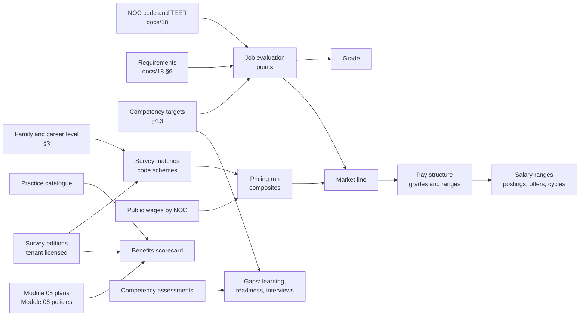

# 19 · Job architecture, competencies, job evaluation and total rewards benchmarking

Oct 24, 2026 · @Wael

This document defines how CanDo helps an organization answer three questions about every job:

- **What is the job worth inside the organization?** Job architecture (families and career levels) and gender-neutral job evaluation.
- **What does the market pay for it?** Salary surveys the organization buys or takes part in, public wage data by NOC code, market pricing, market lines, pay structures and ranges.
- **How do our benefits and practices compare?** Benefits, time-off, work-arrangement and allowance benchmarking, and total rewards valuation.

It also adds the competency framework that recruiting, performance, learning and succession share, and shows how competencies support classification and job evaluation without replacing them. It builds on `docs/18`: NOC codes, survey matches, career levels and job families are all code schemes, and requirements come from there.

**Precedence.** Where `requirements/01`, `02`, `04`, `05`, `07`, `08`, `09`, `12` or `13` says something different on these topics, this document wins. §18 lists every place that changes. The schema is `schema/0005_total_rewards.sql`, applied as migration 0005 in Step 1 and checked by `tests/schema/schema_0005_smoke.sql`. The data is in `rules/job-architecture/`, `rules/competencies/`, `rules/job-evaluation/` and `rules/total-rewards/`. The calculations are specified by `reference/market_pricing_reference.py` and `tests/compensation/market_pricing_cases.json`. The API is `api/openapi-total-rewards.yaml`. The owner's Module 04 review (`docs/25`, 28 October 2026) wins over this document where they differ.

**The rule behind everything here: measure the job, the market and the person separately, and connect them only through recorded decisions.** A job evaluation rates the job. Market data prices the job. A competency assessment describes a person. CanDo never turns one into another automatically: evidence from one is shown beside the others, and a person decides, with a reason that is kept.

**Survey content belongs to its publisher.** CanDo ships no survey data, survey job descriptions or survey level definitions. A tenant imports its own licensed copy of each survey, and CanDo enforces who may see it. The career levels, competency scale descriptors, job evaluation plan and practice catalogue in `rules/` are written for CanDo.

---

## 1. What this has to do

| Need | How CanDo meets it | Section |
| --- | --- | --- |
| A job architecture people can benchmark with | Job families, sub-families and fifteen career levels in four tracks, as code schemes a tenant can change | §3 |
| Competencies that fit job classification and job evaluation | One framework with levels and behavioural indicators; target levels on jobs and positions; a crosswalk that offers competency targets as evidence when evaluating a job | §4, §5.5 |
| Job evaluation that holds up under pay equity law | A versioned point-factor plan covering skill, effort, responsibility and working conditions, with gender-neutral checks, evidence and a rationale for every rating | §5 |
| Benchmark pay against salary surveys | A survey library with licences, editions, job catalogues, data cuts and masked statistics; matching through the survey's code scheme; market definitions; aged and blended composites | §6, §7 |
| Benchmark without buying a survey | Public wage data by NOC 2021 code and region, loaded once for every tenant and used automatically for any job with a NOC code | §6.5 |
| Turn the market into pay structures | Market line from evaluated points, grade midpoints, ranges, progression and overlap checks, posting ranges | §7.6 to §7.8 |
| Compare benefits and HR practices | A catalogue of 54 practices, each read from the tenant's own plan and policy setup, compared with survey prevalence and values | §8 |
| Value total rewards | Components and valuation rules for statements and for comparing total cash and benefits | §9 |
| Take part in surveys safely | Survey submission files with stable pseudonyms, data minimization, review and approval | §10 |
| Respect licences and privacy | Survey data visible only to roles the licence allows, enforced in the database; assessments private to the people who need them | §12 |

---

## 2. How the pieces connect

### 2.1 Three measures, kept apart

| Measure | Of what | Stored in | Decided by | Feeds |
| --- | --- | --- | --- | --- |
| Job value | The job's content | `comp.job_evaluation` | Evaluators and, where required, the pay equity committee | Grade, pay equity job class value (Module 13), market line |
| Market value | The job's labour market | `comp.market_composite` in an approved pricing run | Compensation analyst, approved by the compensation owner | Market line, ranges, competitiveness |
| The person | Competencies and performance | `talent.competency_assessment`, `talent.review` | Managers, assessors and calibration | Development, readiness, merit (performance only, Module 07) |

Two consequences are enforced:

1. Competency assessments never feed a grade, a pay equity comparison or a market price.
2. A grade changes only when an approved evaluation is applied through a change set; a market price never changes a grade by itself.

### 2.2 The flow

### 2.3 Benchmarking in eight steps

This is the path an HR person follows in the Benchmarking workspace. Each step is a screen with its own sign-off and can be repeated on its own.

| Step | What the person does | What CanDo does |
| --- | --- | --- |
| 1. Choose benchmark jobs | Picks jobs to price | Proposes jobs that are well populated, cover every level and have current descriptions; shows coverage against the target (default 50% of jobs, `requirements/04`) |
| 2. Add data sources | Imports each survey edition the organization holds | Validates the file, loads the job catalogue as the survey's code scheme, keeps the licence and file hash; public wages by NOC are already there |
| 3. Match | Confirms a survey job for each benchmark | Suggests matches from family and level mappings and the survey benchmark similarity profile (`docs/18` §7.4); records match quality, duties match and shares for blended jobs |
| 4. Define the market | Chooses sources, weights, cuts, the target percentile and lead or lag | Proposes cuts that fit the organization (region from locations, size from headcount and budget) and the target from the compensation philosophy |
| 5. Price | Runs pricing to a common date | Applies minimum samples, ageing, blending and weights; shows the lineage of every number; marks jobs with insufficient data rather than inventing values |
| 6. Compare | Reviews competitiveness | Market ratio and compa-ratio by job, family, level and location; hot jobs; gaps against the philosophy |
| 7. Act | Builds or updates the structure, or plans adjustments | Market line, grades, ranges, cost to minimum and modelling (§7.6 to §7.9); off-cycle adjustments go through `requirements/04` |
| 8. Benefits and practices | Reviews the scorecard | Compares every practice the organization offers with survey prevalence and values, per benefit class (§8) |

---

## 3. Job architecture

### 3.1 Families, sub-families and career levels

A job architecture places every job in a family (what kind of work) and a career level (how much scope, autonomy and influence). Surveys, pay structures, competency targets and career paths all read it, so it is the first thing a tenant sets up.

Both are tenant code schemes (`docs/18` §3), switched on from templates:

| Scheme | Template | Structure and order | Applies to |
| --- | --- | --- | --- |
| `JOB_FAMILY` | 14 starter families with example sub-families (`career-levels.json`) | Hierarchical: family › sub-family; alphabetical by title | Job |
| `CAREER_LEVEL` | 15 levels in four tracks | Flat; custom rank (the `rank` value) so levels sort and compare across tracks | Job, with position override |

The fifteen CanDo levels:

| Track | Level | Name | People | Typical TEER | Typical points | Default competency targets (core / functional / leadership) |
| --- | --- | --- | --- | --- | --- | --- |
| Support and operations | S1 | Entry support | none | 4–5 | 180–300 | 1 / 1 / – |
| | S2 | Support | none | 3–4 | 240–380 | 2 / 2 / – |
| | S3 | Senior support or skilled | work direction | 2–3 | 320–460 | 2 / 3 / – |
| | S4 | Lead hand or specialist | work direction | 2–3 | 380–520 | 3 / 3 / team leadership 2 |
| Professional and technical | P1 | Developing professional | none | 1–2 | 340–480 | 2 / 2 / – |
| | P2 | Professional | none | 1–2 | 420–580 | 3 / 3 / – |
| | P3 | Senior professional | work direction | 1 | 500–660 | 3 / 4 / strategy and change 2 |
| | P4 | Expert | work direction | 1 | 580–740 | 4 / 4 / team 2, strategy and change 3 |
| | P5 | Principal expert | work direction | 1 | 660–820 | 4 / 5 / team 3, strategy and change 4 |
| Management | M1 | Supervisor or team lead | supervises | 0–2 | 440–600 | 3 / 3 / 2, team leadership 3 |
| | M2 | Manager | supervises | 0 | 520–700 | 3 / 3 / 3, team leadership 4 |
| | M3 | Senior manager | manages managers | 0 | 620–800 | 4 / 4 / 4, strategy 3 |
| | M4 | Director | manages managers | 0 | 700–880 | 4 / 4 / 4 |
| Executive | E1 | Executive | leads a function | 0 | 800–960 | 5 / 4 / 5 |
| | E2 | Chief executive | leads the organization | 0 | 880–1000 | 5 / 4 / 5 |

Each level in `career-levels.json` also describes scope, autonomy, problem solving and influence in English and French, so the level can be chosen from what the job does. A level is chosen for the work, not for the person's pay, performance or tenure.

A tenant can rename, remove or add levels (a small organization may use only S2, S3, P2, P3, M1, M2 and E2), or replace the scheme with its own. Typical TEER, points and competency defaults are hints for suggestions and warnings only. The owner accepted the default competency targets above as CanDo's starting targets on 28 October 2026 (`docs/25` §9).

### 3.2 Job codes

The recommended job code is family, sub-family and level, for example `CSV-YTH-P2` for a youth program professional. It is a recommendation: the job's code is free text in `core.job_version.code`, and family and level are always held as code assignments, so reports never parse a code.

### 3.3 Consistency warnings

Three consistency rules (`docs/18` §5.3) ship with the template, all with severity `warning`:

| Rule | Fires when |
| --- | --- |
| `LEVEL_TEER` | The job's NOC TEER is outside the level's typical TEER |
| `LEVEL_POINTS` | The job's approved evaluation points are outside the level's typical points |
| `LEVEL_PEOPLE` | A management level on a position with no reports, or an individual-contributor level on a position with reports |

A warning shows in the change set and in the job architecture report. It never blocks a change.

### 3.4 Mapping the architecture to a survey

Most salary surveys build their job codes from a family, often a sub-family, and a level. CanDo keeps those parts as attributes of each survey job value (`family`, `subFamily`, `level`). A tenant maps its own families and levels to the survey's once per survey, in `core.code_mapping` (`docs/18` §5.1):

| From | To | Example |
| --- | --- | --- |
| `JOB_FAMILY` value | Survey family or sub-family | `FIN-PAY` → the survey's payroll sub-family |
| `CAREER_LEVEL` value | Survey level | `S3` → the survey's experienced individual contributor level; `M1` → its first-line management level |

With both mappings in place, every job gets a proposed survey match by combining them. The proposal is checked against the survey job's title and description with the survey benchmark similarity profile and shown with its reasons. Nothing is matched until a person accepts it (§6.3). Mappings are kept per survey and carry over to the next edition when the survey's codes do not change.

---

## 4. Competencies

### 4.1 Frameworks and versions

A competency framework is a set of competencies grouped in domains, a level scale, and behavioural indicators for each competency at each level. A tenant can hold several frameworks, for example one organization-wide and one for a regulated profession, and each has versions:

| Status | Meaning |
| --- | --- |
| `draft` | Being written; competencies and indicators can change |
| `published` | In use; nothing in it can change. A correction is a new version |
| `retired` | No longer offered for new targets; history keeps it |

Targets and assessments point to a competency in a specific version, so a past review always shows the indicators the person was assessed against. When a new version is published, CanDo proposes moving targets to it competency by competency (same code means same competency); the move is a change set.

### 4.2 The Unified Competency Model

The owner's Unified Competency Model is loaded as the starting framework `UCM`, version `1.0`, from `rules/competencies/unified-competency-model.json`. The owner accepted it as written on 28 October 2026, and the loader publishes it as CanDo's starting framework, which each organization copies and edits (`docs/25` §9):

| Domain | Competencies |
| --- | --- |
| Core – Organizational | Values and ethics (VAL), client-centred practice (CLI), communication and collaboration (COM), adaptability and learning agility (ADA), results orientation (RES) |
| Leadership | Team leadership (TLD), strategic thinking (STR), change leadership (CHG) |
| Functional | Cross-cultural responsiveness (CCR), needs assessment and navigation (NAV), service planning and coordination (SPC), digital and information literacy (DIG) |

Five levels, five indicators per competency per level: 300 indicators in all.

Two changes were made in loading:

- **Encoding repaired and labels normalized.** Apostrophes and quotation marks from the workbook were fixed, and the level column was converted to numbers.
- **Functional indicators reviewed.** In the workbook, the four functional competencies repeat the same five examples at every level. Those examples are kept as `original_examples` (they read as level 2 practice). A progression from level 1 to level 5 was proposed and accepted by the owner, and is marked `indicators_status: "reviewed"`.

The scale descriptors are written for CanDo, in English and French:

| Level | Name | Descriptor (short) |
| --- | --- | --- |
| 1 | Foundational | Applies it in routine, well-defined situations with guidance; influence on own tasks |
| 2 | Applied | Applies it independently in typical situations and adapts to the person; influence on own work and clients |
| 3 | Proficient | Applies it in complex or unfamiliar situations and coaches others; influence on the team |
| 4 | Advanced | Shapes practice across a program, function or department through standards, systems and partnerships |
| 5 | Strategic | Sets direction across the organization or the wider system |

Definitions and indicators need French versions before French-speaking tenants use the framework (`docs/16` Q28).

### 4.3 Targets on jobs and positions

A competency target says how well the job needs a behaviour to be performed. It is held on the job and inherited by its positions, like codes and requirements (`docs/18` §4.4):

| Field | Meaning |
| --- | --- |
| Competency | A competency in a published framework version |
| Required level | Level for full performance in the job |
| Entry level | Level expected at hire, if lower; the gap is the development plan for the first year |
| Criticality | `critical`, `important` or `useful`; used in interview kits, gaps and readiness |
| Source | `career_level_default`, `job`, `position`, `manual`, `assistant` |
| Reason | Required when a position overrides its job's target |

When a job gets a career level, CanDo proposes the level's defaults for the framework's core, functional and leadership domains (§3.1). The job owner accepts, changes or removes each one. Targets are effective-dated and change through change sets.

### 4.4 How competencies fit with classification and evaluation

Four things describe a job in CanDo, and each answers a different question:

| Item | Question it answers | Example for a youth outreach worker | Where |
| --- | --- | --- | --- |
| NOC code and TEER | What kind of work is this, and what is the usual way into it? | 42201 Social and community service workers, TEER 2 | `docs/18` §2 |
| Requirements | What must a person have to be hired? | College diploma in social services or equivalent; vulnerable sector check; driver's licence | `docs/18` §6 |
| Competency targets | How well must the person perform key behaviours? | Client-centred practice 3, needs assessment and navigation 3, cross-cultural responsiveness 3 | §4.3 |
| Job evaluation | How much is the job worth compared with other jobs? | 560 points, grade G06 | §5 |

A competency target is not a requirement. A target becomes a hiring requirement only when someone adds a requirement of kind `competency`, with its own rationale, through `docs/18` §6.

Job evaluation uses targets as evidence (§5.5). A job that needs team leadership at level 4 is likely to rate high on responsibility for people. The evaluator still reads the job content and chooses the degree.

### 4.5 Assessing people

An assessment records a person's level on one competency, on a date, from a source:

| Source | Typical use |
| --- | --- |
| `self` | Self-assessment in a review or development plan |
| `manager` | Manager's assessment in a review |
| `peer_360` | Aggregate of a 360° survey, never individual raters (Module 07 minimum rater counts apply) |
| `assessment` | A structured assessment, such as an interview panel, simulation or test |
| `evidence` | Evidence-based, for example a credential that demonstrates a level |
| `calibrated` | Result of calibration; overrides the others for the same date |

An assessment is `draft` until finalized; a final assessment cannot change, and a correction is a new assessment that supersedes it. For gaps, CanDo uses the most recent final assessment from the accepted sources (by default all except `self`, which is shown beside it).

Assessments are personal information. They are visible to the person, their line manager, HR roles with talent access and, for selection, the hiring panel. They are not used to rank or reject candidates automatically (`requirements/02` ethics rules).

### 4.6 Gaps and where they are used

A gap is the required (or entry) level minus the assessed level for each target of the person's position. `talent.competency_gap(assignment, date)` returns them, with the position's targets replacing the job's for the same competency.

| Module | Use |
| --- | --- |
| 02 Recruitment | Interview kits pick questions for the job's critical and important competencies at the target level, from question banks tagged by competency and level; probation reviews use entry levels |
| 07 Performance | The competency section of a review lists the job's targets; managers assess against the indicators of that level |
| 08 Learning | Learning items are tagged with competency and level; gaps propose learning paths |
| 09 Succession | Readiness shows gaps against the target position's targets, beside the similarity score and requirement gaps from `docs/18` §7; career paths combine both |
| 12 Analytics | Gap heatmaps by unit and competency, with groups under five people suppressed |

---

## 5. Job evaluation

### 5.1 Plans and versions

A job evaluation plan has a method and versions. The default method is `point_factor`. `classification`, `ranking` and `market_slotting` can be recorded for organizations that use them, but only a point-factor plan produces the scores Module 13 uses to compare job classes.

A plan version is `draft`, `published` or `retired`. A version can be published only when:

- every factor has degrees numbered from 1 with no gaps, and points that rise with each degree;
- the factors' maximum points add up to the plan's maximum;
- for a plan used for pay equity, all four factor groups are present (skill, effort, responsibility, working conditions) and a gender-neutral review is recorded (§5.3).

Once published, factors, degrees and evidence links cannot change.

### 5.2 The CanDo sample plan

`rules/job-evaluation/sample-point-factor-plan.json` is a starting point a tenant copies, reviews with its committee or advisers, and publishes as its own version. It has 12 factors and 1,000 points:

| Group (points) | Factor | Degrees | Max points |
| --- | --- | --- | --- |
| Skill (400) | K1 Knowledge | 8 | 200 |
| | K2 Experience | 5 | 100 |
| | K3 Communication and relationship skill | 5 | 100 |
| Effort (150) | E1 Mental effort | 5 | 75 |
| | E2 Physical effort | 5 | 25 |
| | E3 Emotional effort | 5 | 50 |
| Responsibility (350) | R1 Decision-making and impact | 6 | 120 |
| | R2 Responsibility for people | 5 | 100 |
| | R3 Responsibility for the wellbeing of others | 5 | 70 |
| | R4 Responsibility for resources and information | 5 | 60 |
| Working conditions (100) | W1 Physical environment | 5 | 50 |
| | W2 Psychological environment | 5 | 50 |

Degrees step evenly (degree *n* is *n* × the factor's step), from 181 points at the lowest degrees to 1,000 at the highest. Ten sample grade bands convert points to grades: G01 180–249, G02 250–319, G03 320–389, G04 390–459, G05 460–529, G06 530–609, G07 610–689, G08 690–779, G09 780–879 and G10 880–1000.

### 5.3 Gender-neutral by design

The pay equity laws of Ontario, Quebec and the federal jurisdiction require comparing the value of work using skill (qualifications in Quebec), effort, responsibility and working conditions, with a method free of gender bias. The sample plan is built for that:

- Knowledge is rated as the job needs it, however gained, so skills learned through experience, caregiving or community work count.
- It rates demands that older plans missed in female-predominant work: emotional effort, responsibility for others' wellbeing, communication and relationship skill, fine motor and repetitive work, interruptions and competing demands, confidential information, and exposure to bodily fluids.
- E3 (managing one's own emotions) and W2 (a hostile or unpredictable setting) are defined so the same demand is not counted twice.
- Descriptors use work content, not job titles or gendered examples.

Before a tenant publishes a plan for pay equity, its committee or the employer pilots it on female- and male-predominant job classes and records the review (who, when, findings) on the plan version. CanDo refuses to publish a pay equity plan without that record. CanDo does not decide whether a plan complies; the employer and its advisers do. The plan stays a sample until a pay equity adviser reviews it (`docs/25` §10.2, `docs/16` Q29).

### 5.4 Evaluating a job

| State | Meaning |
| --- | --- |
| `draft` | An evaluator rates each factor |
| `in_review` | The committee or second evaluator reviews |
| `approved` | Points and grade are fixed; nothing can change |
| `superseded` | A later approved evaluation replaced it |
| `withdrawn` | Abandoned before approval |

The evaluation screen shows the job's evidence beside each factor:

- the job description version being evaluated;
- NOC code and TEER;
- active requirements;
- competency targets;
- direct and indirect reports from the position tree;
- physical demand and working condition requirements.

For each factor, the evaluator chooses a degree and writes a rationale. Where the crosswalk (§5.5) suggests a range of degrees, a rating outside it needs a reason as well.

Rules:

- **Approval.** Approval needs a rating for every factor. On approval, CanDo computes total points and the grade from the plan's bands, and records the committee members and the approver.
- **Conflict of interest.** No one rates or approves the evaluation of their own job or of a job they report to.
- **Immutability.** An approved evaluation never changes. A re-evaluation is a new evaluation that names the one it supersedes; approving it marks the old one `superseded` in the same transaction.
- **One at a time.** There is one approved evaluation per job (or per position, for position-specific evaluations) per plan at any time.
- **Applying the result.** An approved evaluation proposes the grade for the job as a change set. It does not change the grade itself.
- **Requests from employees.** An employee or manager can ask for a re-evaluation. The request is a case in Module 13, with the response tracked there and the agreement's classification grievance rules applied where there is one.

### 5.5 Evidence crosswalk

| Factor | Evidence | Suggestion |
| --- | --- | --- |
| K1 Knowledge | NOC TEER of the job | TEER 5 → degrees 1–2; TEER 4 → 2–3; TEER 3 → 3–4; TEER 2 → 4–5; TEER 1 → 6–7; TEER 0 → 5–8 |
| K2 Experience | Career level | For example S3 → 3–4, P2 → 2–4, M2 → 3–5 |
| K3 Communication | Highest target among COM, CLI, CCR | Level 1 → 1–2; 2 → 1–3; 3 → 2–4; 4 → 3–5; 5 → 4–5 |
| E1 Mental effort | Highest target among RES, ADA, STR | Same as K3 |
| E2 Physical effort | Physical demand requirements | Shown, no range suggested |
| E3 Emotional effort | Working condition requirements; CLI and CCR targets | Shown, no range suggested |
| R1 Decision-making | Highest target among STR, RES, CHG | Level 1 → 1–2; 2 → 2–3; 3 → 3–4; 4 → 4–5; 5 → 5–6 |
| R2 Responsibility for people | Highest target among TLD, CHG; reports in the position tree | None → 1–2; 1 → 1–2; 2 → 2–3; 3 → 3–4; 4 → 4–5; 5 → 5 |
| R3 Wellbeing of others | Highest target among CLI, NAV, SPC, VAL | Level 1 → 1–2; 2 → 2–3; 3 → 2–4; 4 → 3–5; 5 → 4–5 |
| R4 Resources and information | Highest target among DIG, RES | Same as K3 |
| W1, W2 | Working condition requirements | Shown, no range suggested |

The crosswalk belongs to the plan version (`comp.je_evidence_link`), so a tenant with its own framework or factors sets its own links. Suggestions are proposals: they never set a degree.

### 5.6 From points to grades and pay equity

- **Grade.** The approved points fall in one band of the plan version; that band's grade is proposed for the job. Where the structure is built from the market line (§7.6), the same bands set the midpoints.
- **Pay equity.** Module 13 reads approved evaluations to value job classes, compare female- and male-predominant classes, and run maintenance when jobs change. Job class membership and gender predominance stay in Module 13.
- **Maintenance.** When a job's description, requirements or targets change after its evaluation was approved, the evaluation is flagged for review and the pay equity maintenance log records the change.

### 5.7 Worked examples

From the sample plan's `worked_examples`, checked by cases JE-001 and JE-002:

| Factor | Youth outreach worker (CSV-YTH-P2, NOC 42201) | Payroll coordinator (FIN-PAY-S3, NOC 13102) |
| --- | --- | --- |
| K1 Knowledge | 5 (125) | 4 (100) |
| K2 Experience | 2 (40) | 3 (60) |
| K3 Communication | 3 (60) | 2 (40) |
| E1 Mental effort | 3 (45) | 3 (45) |
| E2 Physical effort | 2 (10) | 2 (10) |
| E3 Emotional effort | 4 (40) | 1 (10) |
| R1 Decision-making | 3 (60) | 3 (60) |
| R2 People | 2 (40) | 1 (20) |
| R3 Wellbeing of others | 4 (56) | 1 (14) |
| R4 Resources and information | 2 (24) | 4 (48) |
| W1 Physical environment | 3 (30) | 1 (10) |
| W2 Psychological environment | 3 (30) | 1 (10) |
| **Total and grade** | **560, G06** | **427, G04** |

For the youth outreach worker, every rating with a suggestion falls inside it (P2 defaults, TEER 2). The outreach job's emotional effort, responsibility for wellbeing and working conditions are what a plan without those factors would miss.

---

## 6. Salary surveys and public wage data

### 6.1 The survey library

Each survey a tenant uses is recorded once, with its editions:

| Field | Meaning |
| --- | --- |
| Code, name, publisher | As the tenant names them |
| Code scheme | The tenant code scheme (purpose `salary_survey`) that holds the survey's job catalogue (`docs/18` §3) |
| Licence | Licensee; allowed uses (internal pricing, combining with other sources, aggregate reporting to the board); whether employees may see survey figures; expiry; whether data must be deleted at expiry |
| Access role | The role that may see this survey's data; enforced in the database (§12) |
| Participation | Whether the tenant submits data to the survey (§10) |

CanDo does not judge licence terms. It records what the tenant enters and enforces it. A survey with an expired licence is hidden from pricing. If the licence says to delete at expiry, a scheduled job removes its market data and job descriptions and keeps only the audit record.

### 6.2 Editions and import

An edition is one publication of a survey:

- effective date and publication date;
- participant count and currency;
- the hours basis for annualizing hourly data;
- the masking rules it publishes (for example, the minimum number of organizations needed to show a median);
- the weightings it reports (organization or incumbent);
- the file hashes.

Import uses a profile from `rules/total-rewards/survey-import-profiles.json`. The profiles cover:

- one row per job, cut and weighting, with statistics as columns;
- one row per job, cut, weighting and element;
- the job catalogue;
- the cut dictionary;
- benefits and practice prevalence.

These generic profiles are what CanDo offers at launch; a publisher's own template is added when a customer sends a sample file and the publisher allows it (`docs/25` §8.3).

The wizard proposes a profile from the column headers. The analyst confirms it, picks the number locale (English or French Canadian), and runs a dry run that lists errors (block publishing) and warnings (shown):

- **Errors:** job not in the catalogue, duplicate key, percentiles out of order, negative value, not a number, unknown cut.
- **Warnings:** a statistic shown below the published masking rule, mean outside P10 to P90, hourly and annual figures disagreeing, large change from the prior edition.

Publishing an edition:

1. loads the job catalogue as values of the survey's code scheme, valid from the edition's effective date (unchanged codes keep their values; new codes are added; codes the edition drops are ended);
2. loads cuts and market data;
3. makes the edition read-only.

Masked or blank values are stored as nulls, with the statistics the publisher masked listed. CanDo never fills, estimates or reverse-engineers a masked value.

### 6.3 Matching jobs to a survey

A survey match is a code assignment in the survey's scheme (`docs/18` §4), so it has dates, history, inheritance and change sets for free:

- **Target.** Matches are normally on the job and inherited by its positions. A position can override when its work differs (with a reason). An incumbent's assignment can override for submissions, for example a job share where one person does the senior half.
- **Quality.** `exact`, `close`, `partial` or `blended`, with the share of each survey job for blended matches; shares total 100 (`docs/18` CODE-011).
- **Duties match.** The analyst records the estimated share of the survey job's main duties the job performs. A match below the survey's threshold is refused unless it is marked `partial` with a reason. The threshold defaults to 70% (`requirements/04`) and can be set per survey to its own rule.
- **Level by responsibility.** The match screen reminds the analyst to choose the survey level from the work, not from pay, performance or the person's title.
- **One per position held.** For submissions, each incumbent position (assignment) has exactly one match per survey; a person in two matched positions is two incumbents (`docs/20` §7). Blended matches are for pricing only.
- **Suggestions.** From the architecture mapping (§3.4), similarity (`docs/18` §7.4) and last edition's match. Accepting a suggestion records it as the source.
- **Coverage.** A meter shows the share of benchmark jobs, positions and incumbents matched, by family and level.

### 6.4 Data cuts

A cut is a subset of participants, such as a region, a size band by employees or budget, a complexity tier or a sector focus. Each source in a market definition names a chain of cuts in order of preference, ending with the all-participants cut. CanDo proposes the chain from the tenant's own profile:

- region from the locations of the matched positions;
- employee size from headcount;
- budget size from finance (`docs/17` §8);
- sector from the tenant's settings.

Pricing uses the first cut in the chain that is usable for every matched survey job (§7.2).

### 6.5 Public wage data by NOC

Employment and Social Development Canada publishes Job Bank wage data for every NOC 2021 unit group:

- **Figures.** Low, median and high hourly wages; in most cases low is the 10th percentile and high the 90th.
- **Annual wages** for a few occupations with many self-employed workers.
- **Geography.** Canada, each province and territory, and regions within provinces.
- **Sources.** Mainly the Labour Force Survey, pooled over two calendar years (2023–2024 in the November 2025 update).
- **Updates and download.** Updated each fall and available from the Government of Canada open data portal.

CanDo loads each update once, for all tenants, as reference data (`ref.public_wage_edition`, `ref.public_wage`), the same way as NOC (`docs/18` §2.4). Any job with a NOC code can then be priced against it with no matching work, because the match is the NOC code itself.

| Point | Rule |
| --- | --- |
| Statistics | `p10` from low, `p50` from median, `p90` from high; `p25`, `p75` and mean are not available from this source |
| Annualizing | Hourly figures × the market definition's hours basis (for example 1,950 for a 37.5-hour week) |
| Effective date | The middle of the reference period (1 January 2024 for 2023–2024), for ageing |
| Geography | The market definition's chain, for example region › province › Canada |
| Fit | An occupation covers all levels and experience; default match quality `partial` and default weight 30% next to a survey, or 100% when there is no survey |
| Licence | Open Government Licence – Canada, with attribution; confirmed at each load (`docs/16` Q30) |

Public wages are most useful for support, skilled and professional jobs (TEER 1 to 5). For management and executive levels, the analyst is warned that an occupation median mixes levels.

---

## 7. Market pricing

### 7.1 Market definitions

A market definition says how a group of jobs is priced:

| Field | Meaning |
| --- | --- |
| Applies to | Job families, career levels, locations or a list of jobs; one definition can be the default |
| Sources | Each survey edition or public wage edition, with weighting (organization or incumbent), element (base salary, total cash…), cut chain or geography chain, weight, optional geographic differential |
| Statistic | The percentile or mean the philosophy targets (`requirements/04`), for example P50 |
| Adjustment | Lead or lag, as a percentage (+5 to lead the market by 5%) |
| Statistics kept | Other statistics stored alongside, by default P25, P50 and P75 |
| Minimum sample | Minimum organizations and, optionally, incumbents for a value to be used; never lower than the edition's own masking |
| Minimum sources | How many sources must be usable to price a job (default 1) |
| Ageing | Method (`none`, `simple`, `compound`) and annual rate, optionally by element |

### 7.2 Usable values

A value is used only if it is published (not masked) and its counts meet the definition's minimum. For a source, pricing takes the first cut in the chain where every matched survey job is usable for the target statistic. The other statistics come from the same cut, and a statistic the source does not publish there is left out for that source. If no cut works, the source is not used for that job and the lineage says why: `NOT_MATCHED`, `NO_USABLE_CUT`, `NO_NOC_CODE` or `NO_USABLE_GEOGRAPHY`.

### 7.3 Ageing

Every value is aged from its edition's effective date to the run's common date:

- **Months.** Whole calendar months, plus the difference in day of month as a fraction of 30, rounded to 2 decimals. 1 April 2025 to 1 January 2026 is 9.00 months; to 15 January 2026, 9.47.
- **Simple:** factor = 1 + rate × months ÷ 12 (`requirements/04`).
- **Compound:** factor = (1 + rate) ^ (months ÷ 12).
- A common date before the effective date ages backwards and is flagged.

### 7.4 Composite

For each job:

1. **Within a source.** A blended match is the share-weighted sum of its survey jobs' values in the chosen cut. Example: 60% × 50,800 + 40% × 61,500 = 55,080.
2. **Ageing and geography.** The source value is multiplied by the ageing factor and by 1 + the geographic differential.
3. **Across sources.** Usable sources are averaged by weight; the weights of unusable sources are spread over the usable ones. Each statistic uses the sources that publish it.
4. **Target.** The composite at the target statistic × (1 + adjustment).

All arithmetic is decimal and rounding is half-up to the cent at the end of each result. The reference implementation is the specification.

### 7.5 Pricing runs

A pricing run applies one market definition to its jobs at a common date:

- **States.** `draft`, then `approved` (frozen, with approver and time), then `superseded` when a later run for the same definition is approved.
- **What is stored.** Each job's composite holds the market statistics, the target and its lineage: every source with its cut or geography, counts, raw value, ageing factor, weight, whether it was used and why not.
- **New data.** When a new edition is published, runs that used the previous edition are marked stale and a new draft is offered.

### 7.6 Market line

The market line relates evaluated points to market targets over priced benchmark jobs:

> ln(market target) = a + b × points

It is fitted by least squares over at least three jobs (eight or more across the range is recommended). The fit shows:

- R²;
- the progression per 100 points: e^(100 × b) − 1;
- each job's residual; any job more than 15% (configurable) above or below the line is flagged as an outlier for review.

An outlier is not removed automatically. The analyst can exclude it from the fit with a reason, or treat it as a hot job.

LINE-001 fits eight jobs, from 300 points at $42,000 to 860 points at $152,000:

- a = 9.9486059631 and b = 0.0020975312;
- R² = 0.9545, which PostgreSQL's `regr_*` functions confirm;
- 23.34% progression per 100 points;
- the 860-point job sits 19.6% above the line, and is flagged.

### 7.7 Grades and ranges

From the market line and the plan's grade bands:

| Item | Rule |
| --- | --- |
| Midpoint | e^(a + b × middle of the band's points), rounded to the structure's unit (default $100, half-up) |
| Minimum | Midpoint ÷ (1 + spread ÷ 2), rounded to the unit (`requirements/04`) |
| Maximum | Minimum before rounding × (1 + spread), rounded to the unit |
| Progression | Each midpoint ÷ the one below − 1; typical 15–20% (`requirements/04` step 6) |
| Overlap | The part of a grade's range below the next lower grade's maximum, as a share of the grade's range |

A new structure starts each grade's spread from the organization's spreads by career track (`comp.range_spread_by_track`: support 30%, professional 40%, management 50%, executive 60%; `docs/25` §4.1).

STRUCT-001 builds ten grades from LINE-001, with spreads of 30% (G01–G03), 40% (G04–G06), 50% (G07–G08) and 60% (G09–G10):

| Grade | Minimum | Midpoint | Maximum | Progression |
| --- | --- | --- | --- | --- |
| G01 | 28,500 | 32,800 | 37,100 | – |
| G02 | 33,000 | 38,000 | 43,000 | 15.9% |
| G03 | 38,300 | 44,000 | 49,700 | 15.8% |
| G04 | 42,500 | 51,000 | 59,500 | 15.9% |
| G05 | 49,200 | 59,000 | 68,800 | 15.7% |
| G06 | 57,600 | 69,100 | 80,600 | 17.1% |
| G07 | 65,400 | 81,700 | 98,000 | 18.2% |
| G08 | 78,200 | 97,700 | 117,200 | 19.6% |
| G09 | 91,700 | 119,200 | 146,700 | 22.0% |
| G10 | 115,600 | 150,300 | 185,000 | 26.1% |

Smoothing is the analyst's: midpoints can be edited before approval, and each edit is recorded with its reason.

**Pay structure versions** are `draft`, `approved` or `superseded`. Two approved versions of one structure cannot overlap in dates. A version is approved through the organization's route, and a market-based version also needs an approved compensation philosophy (`docs/25` §3, §4.2). Approving a version:

- writes its grades to `comp.salary_range`, linked to the version;
- recomputes compa-ratios;
- flags open requisitions whose posting range changes.

**Posting ranges.** A posting shows the range Module 02 needs, from the grade:

- In British Columbia, a publicly advertised posting must include the expected pay or range.
- In Ontario, from 1 January 2026, a range in a public posting can be no wider than $50,000. Postings whose expected pay is above $200,000 are exempt.

When a grade's range is wider than a posting rule allows, CanDo proposes a posting range centred on the hiring zone (minimum to midpoint by default). The analyst confirms it on the requisition.

### 7.8 Structures without job evaluation

Organizations without a point-factor plan can build a market-based structure: each benchmark is slotted into the grade whose midpoint is closest to its market target, and non-benchmark jobs are slotted by comparison (`requirements/04` steps 7 and 8). Collective agreement grids are never built from the market; they are imported from the agreement library and compared with it.

### 7.9 Competitiveness and pay metrics

Per job, family, level, location and organization:

| Metric | Formula |
| --- | --- |
| Market ratio | Pay ÷ market target |
| Compa-ratio | Pay ÷ range midpoint |
| Penetration | (Pay − minimum) ÷ (maximum − minimum) |
| Quartile | Q1 below 0.25 penetration, Q2 below 0.50, Q3 below 0.75, Q4 up to the maximum; `below_minimum` and `above_maximum` outside the range |
| Cost to minimum | Sum of (minimum − rate) × FTE for everyone below minimum |

Ratios are rounded to three decimals. Pay is the annual full-time base rate from the assignment's rate components, using `base` plus `market_supplement` and `out_of_schedule` where the report asks for total base (`docs/17` §6.1).

Group results follow the Module 12 minimum group size, so no report reveals one person's pay to someone not allowed to see it.

---

## 8. Benefits and HR practice benchmarking

### 8.1 The practice catalogue

`rules/total-rewards/benefit-practices.json` lists 54 practices in ten categories:

- health and dental;
- spending accounts;
- life and disability;
- retirement and savings;
- time off and leave;
- wellness;
- learning;
- work arrangements;
- allowances;
- pay practices.

Each practice has:

| Field | Meaning | Example |
| --- | --- | --- |
| Value type | `boolean`, `money`, `multiple_of_salary`, `percent`, `days`, `weeks`, `months`, `count`, `enum`, `text` | Basic life insurance: `multiple_of_salary` |
| Richer when | `higher`, `lower` (waiting periods), `yes`, or `none` (shown, not compared) | Short-term disability waiting period: `lower` |
| Own value source | Where the tenant's value is read | `benefits.plan.design` key `waitingDays` of the `std` plan |

The catalogue is loaded into `ref.reward_practice`. A tenant enables the practices it uses in `benefits.practice` and can add its own.

### 8.2 The tenant's own values

The tenant's values come from its configuration, so a benchmark is never retyped:

- **Plan design.** Module 05 plans gain a `design` object (migration 0005) with standard keys per plan kind, for example drug reimbursement percentage, paramedical maximum, life multiple, waiting days and elimination period. The plan setup screen writes them.
- **Time off and work arrangements.** Resolvers in Module 06 read vacation, sick, personal and holiday entitlements and leave top-ups from the leave policies and agreements, at hire and at maximum.
- **Allowances.** Recurring allowances and expense rates come from Module 03 earning codes.
- **Pay practices.** Increase budgets, incentive eligibility and posting policy come from Modules 02 and 04.

Values are computed per benefit class or agreement, so a unionized group and a non-union group get separate scorecards. A value can be entered by hand with a reason where the setup cannot express it.

### 8.3 Market practice data

Surveys often report the share of participants offering each practice and the distribution of values (for example how many give two, three or four weeks of vacation at hire). The practice prevalence profile loads these into `benefits.practice_market` per edition and cut: organizations, prevalence, P25, P50, P75, most common value and distribution. Survey question codes are mapped to catalogue practices once per survey.

### 8.4 Comparison

For each practice and benefit class:

- **Numbers:** compare the tenant value with the market median. Within the tolerance (5% for money, exact for the other types) is `at_market`. Otherwise it is `richer` or `leaner`, according to `richer_when`.
- **Yes or no:** offered by at least half of the market is common. Offering a common practice is `at_market`; offering an uncommon one is `richer`; not offering a common one is `leaner`.
- **Choices:** compare the position of the tenant's choice with the most common choice in the catalogue's order.
- **Not compared:** `richer_when: none` and text practices are shown with prevalence only.

PRAC-001 covers each direction. The scorecard always shows prevalence beside the result: "richer" means little if only a few organizations report the practice.

### 8.5 Limits

CanDo shows where a plan sits against the market. It does not price plan changes (the carrier and the advisor do) and does not compute an actuarial value of benefits. Where a tenant has a benefits value index from its advisor, it can be imported as a tenant practice of type `percent`.

---

## 9. Total rewards

### 9.1 Components and valuation

| Component | Valuation |
| --- | --- |
| Base pay | Annual base from rate components |
| Variable pay | Incentives and awards paid in the last 12 months (Module 04, 10) |
| Statutory contributions | Employer CPP/QPP, EI, QPIP and health taxes paid (Module 03) |
| Benefits | Employer premiums and contributions paid (Module 05) |
| Retirement and savings | Employer contributions paid; for defined benefit plans, the employer's current service contribution rate × pensionable earnings |
| Paid time off | Paid days off × the daily rate, from Module 06 entitlements |
| Learning | Learning spend on the person (Module 08) |
| Recognition and perks | Recognition awards (Module 10) and recurring allowances |

Components are configured in `comp.total_rewards_component`: category, valuation method, whether shown on statements, whether included in benchmarking.

### 9.2 Statements

Total rewards statements (`requirements/04`) use these valuations; they are produced on request by default (`docs/25` §8.4). Statements never show survey figures for a job unless the survey's licence allows sharing with employees. A statement can show the employee's range and position in it at the transparency level the employer chose.

### 9.3 Total rewards benchmarking

Cash and benefits are compared separately, because surveys measure them differently:

- **Cash.** Total cash (base plus incentive paid) is priced like base pay when the survey publishes it.
- **Benefits and practices.** The scorecard in §8.
- **No single index.** CanDo does not combine cash and benefits into one index unless the tenant imports one (§8.5).

---

## 10. Taking part in a survey

### 10.1 What is prepared

A submission is prepared for a survey and the edition being collected, as of a date:

- **Organization profile.** Employees, operating budget, structure complexity, sector focus and regions, derived where CanDo knows them and confirmed by the analyst.
- **Incumbent rows.** One row per incumbent with a survey match, and optionally one per matched vacant position.
- **Practice answers.** The tenant's own values (§8.2) for the survey's practice questions.

### 10.2 Incumbent fields

| Field | Source |
| --- | --- |
| Pseudonym | A random identifier per position held (assignment) and survey, stable across years (`comp.survey_pseudonym`); never derived from employee number, name or SIN, and the pseudonyms of one person's two positions cannot be linked (`docs/20` §7) |
| Survey job code and match quality | The incumbent's effective match (§6.3) |
| FTE, annual base, hourly rate | Assignment and rate components, annualized with the survey's hours basis |
| Incentive eligibility, target and paid | Module 04 |
| Location | Region or province at the level the survey asks |
| Other fields | Only those the analyst switches on from the survey's request, such as hire year or bargaining unit |

### 10.3 Privacy and approval

- **Not included by default.** Names, dates of birth, SIN, addresses and contact details are never in a submission. Gender and other self-identification data are included only when the survey asks for them, the tenant switches them on with its privacy officer's approval, and the group is large enough.
- **Pseudonymous is still personal.** A pseudonymous row can still be personal information, so the submission screen asks for the data processing agreement with the survey publisher and the tenant's privacy approval. For Quebec employees, the screen reminds the tenant of its privacy impact assessment for sharing outside Quebec.
- **Approval freezes it.** A submission is `draft`, `in_review`, `approved`, `exported` or `withdrawn`. Approval freezes the rows; export records the file hash, who exported it and when.
- **Lookup.** The pseudonym table lets the analyst answer the publisher's questions about a row. It is visible only to the survey's access role.

---

## 11. Pay equity and pay transparency

| Topic | Link |
| --- | --- |
| Pay equity plans (Ontario, Quebec, federal) | Approved evaluations from a published pay equity plan value job classes in Module 13 |
| Plan review | A plan used for pay equity cannot be published without its gender-neutral review record (§5.3) |
| Maintenance | Job changes after approval flag evaluations and log the change (§5.6) |
| BC pay transparency reports | Built from payroll data in Module 13, not from surveys; employers with 50 or more employees report from 1 November 2026 |
| Posting ranges | From the pay structure, with jurisdiction rules applied in Module 02 (§7.7) |
| Excluded from pay equity | Competency assessments, survey data and individual performance |

Legislative details were checked in October 2026 and are held as effective-dated rules (Module 13).

---

## 12. Security, licences and privacy

| Role | Sees |
| --- | --- |
| `comp_admin` | Everything in compensation for its legal entities, including survey data for surveys whose access role it holds |
| `comp_analyst` | Job architecture, evaluations, structures, pricing runs; survey data only with the survey's access role |
| `survey_data:<survey code>` | The survey's market data, job descriptions and submission pseudonyms |
| `je_evaluator`, `je_committee` | Evaluations assigned to them and the evidence; never pay or survey data |
| `benefits_analyst` | Practice values and scorecards; market practice data with the survey's access role |
| Manager | Their team's ranges, compa-ratios and competency gaps; their team's market ratios only when the organization switches them on (`docs/25` §8.1); no survey data, no evaluations in progress |
| Employee | Own range and position at the employer's transparency level; own assessments and gaps |

**Enforced in the database.** Survey market data, practice market data, survey job descriptions and pseudonyms have a second, restrictive row-level security policy. It allows a row only when the request's roles include the survey's access role. The API sets `app.roles` (a comma-separated list) next to `app.tenant_id` at the start of each request transaction (`docs/02`). Pricing runs store their results and lineage. An approved run can be read by compensation roles without the survey role, because licences generally allow results derived from many sources; a tenant whose licence does not can mark the survey `derived_results_restricted`, and runs that use it then require the role too.

Every import, match, pricing run, approval, export and licence change is audited.

---

## 13. Data model (migration 0005)

| Table | Purpose |
| --- | --- |
| `ref.public_wage_edition`, `ref.public_wage` | Public wage data by NOC code and geography (§6.5) |
| `ref.reward_practice` | The practice catalogue (§8.1) |
| `talent.competency_framework`, `talent.competency_framework_version` | Frameworks and versions; published versions frozen |
| `talent.competency`, `talent.competency_indicator` | Competencies and indicators per level |
| `talent.competency_target` | Required and entry levels on jobs and positions, effective-dated |
| `talent.competency_assessment` | Assessments of people; final ones frozen |
| `talent.competency_gap()` | Gaps for an assignment on a date |
| `comp.je_plan`, `comp.je_plan_version`, `comp.je_factor`, `comp.je_degree`, `comp.je_evidence_link` | Evaluation plans; published versions validated and frozen |
| `comp.job_evaluation`, `comp.job_evaluation_rating` | Evaluations and ratings; points and grade computed on approval; approved ones frozen |
| `comp.survey`, `comp.survey_edition`, `comp.survey_cut`, `comp.market_data` | Survey library and data; percentiles checked in order; masked values null |
| `comp.market_definition`, `comp.market_definition_source` | Market definitions |
| `comp.market_pricing_run`, `comp.market_composite` | Runs and per-job results with lineage; approved runs frozen |
| `comp.pay_structure`, `comp.pay_structure_version`, `comp.pay_grade` | Structures, versions and grades; approved versions cannot overlap |
| `comp.salary_range` (altered) | Gains `structure_version_id` and `basis` |
| `comp.survey_pseudonym`, `comp.survey_submission`, `comp.survey_submission_row` | Survey participation; approved submissions frozen |
| `comp.total_rewards_component` | Total rewards components and valuation |
| `benefits.plan` (altered) | Gains `design` |
| `benefits.practice`, `benefits.practice_market`, `benefits.practice_own_value` | Practices enabled, market data and own values |

All tenant tables have `tenant_id` and the standard tenant policy. Survey-restricted tables add the restrictive policy in §12.

---

## 14. Operations, API and events

`api/openapi-total-rewards.yaml` has the endpoints; it is merged into `api/openapi.yaml` in Step 15. Writes that change jobs, positions, targets, matches, grades or ranges go through change sets (`docs/03`).

| Event | Published when | Cascade |
| --- | --- | --- |
| `competency.framework.published` | A framework version is published | Proposals to move targets to the new version |
| `competency.target.changed` | A target changes on a job or position | Gap refresh; evaluation flagged for review if approved |
| `competency.assessment.finalized` | An assessment becomes final | Gap refresh; learning suggestions (Module 08) |
| `job_evaluation.approved` | An evaluation is approved | Grade proposal as a change set; pay equity maintenance log (Module 13) |
| `survey.edition.published` | An edition is published | Pricing runs on the prior edition marked stale |
| `market_pricing.run.approved` | A run is approved | Competitiveness reports refreshed |
| `pay_structure.version.approved` | A structure version is approved | Salary ranges written; compa-ratios recomputed; open requisitions flagged |
| `survey_submission.exported` | A submission file is exported | Audit only |
| `reward_practice.values.changed` | Own values are recomputed after a plan or policy change | Scorecards refreshed |

---

## 15. Screens

| Screen | Purpose |
| --- | --- |
| Job architecture | Families and levels as a grid; jobs in each cell; warnings from §3.3 |
| Competency framework | Edit a draft version; compare versions; publish |
| Job profile, Competencies tab | Targets with inheritance and overrides |
| Evaluation workspace | Factors with evidence side by side, suggestions, rationale, committee review |
| Survey library | Surveys, licences, editions, access roles |
| Import wizard | Profile, locale, dry run, errors and warnings, publish |
| Matching workbench | Benchmarks with suggested matches, quality, duties match, coverage meter |
| Market definitions | Sources, weights, cuts, statistic, ageing, minimums |
| Pricing run | Results per job with lineage; insufficient data list; approve |
| Structure builder | Market line, outliers, grades, ranges, progression, overlap, modelling |
| Benefits scorecard | Practices by category and benefit class, with prevalence |
| Survey submission | Profile, rows, fields switched on, review, approve, export |

---

## 16. Reports

| Report | Content |
| --- | --- |
| Benchmark coverage | Benchmark jobs, positions and incumbents matched, by family, level and survey |
| Market competitiveness | Market ratio by job, family, level and location, against the philosophy's target |
| Structure health | Progression, spreads, overlap, population by grade, below minimum and above maximum |
| Evaluation consistency | Points against level and grade; warnings from §3.3; evaluations flagged for review |
| Competency gaps | Gaps by unit and competency, small groups suppressed |
| Benefits scorecard | Richer, at market and leaner by category and benefit class |
| Survey usage | Editions in use, licence expiry dates, runs that use each edition |

---

## 17. Acceptance scenarios

| ID | Scenario | Expected | Step |
| --- | --- | --- | --- |
| TR-001 | Publish UCM 1.0 with functional indicators still proposed | Refused until every competency's `indicators_status` is `as_provided` or `reviewed` | 15 |
| TR-002 | Change an indicator in a published framework version | Refused with `FRAMEWORK_VERSION_IMMUTABLE` | 1 |
| TR-003 | Give a job a P2 career level | Core and functional defaults proposed as targets at 3; none active until accepted | 15 |
| TR-004 | Target level 6 on a five-level scale | Refused with `LEVEL_OUTSIDE_SCALE` | 1 |
| TR-005 | Position overrides its job's CLI target without a reason | Refused; accepted with a reason | 1 |
| TR-006 | Gaps for an assignment with a position override and a self and a manager assessment | Position target used; manager assessment used, self shown beside it | 17 |
| TR-007 | Publish a pay equity plan with no working conditions factor, or without a gender-neutral review | Refused with `JE_PLAN_GROUP_MISSING` or `JE_PLAN_REVIEW_MISSING` | 1 |
| TR-008 | Publish a plan whose factor maximums do not add up to the plan maximum | Refused with `JE_PLAN_POINTS_MISMATCH` | 1 |
| TR-009 | Evaluate the youth outreach worker | 560 points, G06; suggestions as JE-001 | 15 |
| TR-010 | Approve an evaluation with a factor missing | Refused with `EVALUATION_INCOMPLETE` | 1 |
| TR-011 | Rate K1 at degree 2 for a TEER 1 job without a reason | Refused with `OUTSIDE_SUGGESTION_NEEDS_REASON` | 1 |
| TR-012 | Approve a re-evaluation that supersedes the current one | Old one `superseded`, new one `approved`, in one transaction; only one approved | 1 |
| TR-013 | Change a rating on an approved evaluation | Refused with `EVALUATION_IMMUTABLE` | 1 |
| TR-014 | Evaluator rates their own job | Refused | 15 |
| TR-015 | Import an edition with P75 below P50 for one row | Dry run error `PERCENTILES_NOT_ORDERED`; nothing published | 1 and 15 |
| TR-016 | Market data for a job code not in the survey's catalogue | Refused with `SURVEY_JOB_NOT_IN_CATALOGUE` | 1 |
| TR-017 | Survey and public wages, aged to 1 January 2026 | As PRICE-001: target 54,271.75; P25 and P75 from the survey only | 15 |
| TR-018 | Blended match with a masked preferred cut | As PRICE-002: both jobs priced from the next cut, 56,314.71 | 15 |
| TR-019 | Survey below the minimum sample | As PRICE-003: weight moves to public wages; lineage `NO_USABLE_CUT` | 15 |
| TR-020 | No match and no NOC code | `insufficient_data`; no value | 15 |
| TR-021 | Market line and grades | As LINE-001 and STRUCT-001; the 860-point job flagged | 15 |
| TR-022 | Approve a structure version overlapping an approved one | Refused | 1 |
| TR-023 | Approve a structure version | Salary ranges written with the version; compa-ratios recomputed; requisitions flagged | 15 |
| TR-024 | Ontario posting for a G10 job (range 115,600 to 185,000) | Posting range proposed within $50,000, centred on the hiring zone | 14 and 15 |
| TR-025 | User without the survey's access role reads market data | No rows returned | 1 |
| TR-026 | Practice scorecard for the non-union class | As PRAC-001 for each direction | 15 |
| TR-027 | Own STD waiting days after a plan design change | Value recomputed; `reward_practice.values.changed` published | 15 |
| TR-028 | Survey submission for two years running, with one person in two matched positions | Same pseudonym for the same position held; two unlinked pseudonyms for the person's two positions; no names, SIN or birth dates in the file | 15 |
| TR-029 | Change a row of an approved submission | Refused with `SUBMISSION_IMMUTABLE` | 1 |
| TR-030 | Survey licence expires with delete at expiry | Market data and descriptions removed; audit record kept; runs that used it keep results | 15 |
| TR-031 | Load Job Bank wages | One edition for all tenants; NOC 2021 codes checked against `ref.code_item`; hourly and annual rows kept as published | 15 |
| TR-032 | Every case in `tests/compensation/market_pricing_cases.json` | The TypeScript port gives the expected values | 15 |

---

## 18. Changes to other documents

| Document | Change |
| --- | --- |
| `requirements/01` Job catalogue and job evaluation | Job evaluation moves to Module 04 and this document (§5); job architecture as code schemes (§3) |
| `requirements/02` Interview kits, postings | Kits from competency targets (§4.6); posting ranges from structures (§7.7) |
| `requirements/04` Compensation | Survey library, matching, market definitions, pricing runs, market line, survey participation, job evaluation, total rewards valuation (§3 to §11) |
| `requirements/05` Benefits | Plan design keys; practice benchmarking (§8) |
| `requirements/07`, `08`, `09` | One competency framework with targets, assessments and gaps (§4) |
| `requirements/12` Analytics | Reports in §16 |
| `requirements/13` Compliance | Pay equity reads approved evaluations; re-evaluation requests are cases (§5.4, §11) |
| `docs/02` Architecture | `app.roles` set per request for restrictive policies (§12) |
| `docs/15` Steps 1, 14, 15 and 17 | Migration 0005 in Step 1; posting ranges in Step 14; frameworks, targets, evaluation, surveys, pricing, structures, practices and submissions in Step 15; assessments and gaps in Step 17 |
| `AGENTS.md` | Reading order item for this document and rules 34 to 36 |
| `api/openapi.yaml`, `api/events.yaml` | Paths in `api/openapi-total-rewards.yaml` and events in §14, merged in Step 15 |
| New files | `schema/0005_total_rewards.sql`, `tests/schema/schema_0005_smoke.sql`, `rules/job-architecture/`, `rules/competencies/`, `rules/job-evaluation/`, `rules/total-rewards/`, `reference/market_pricing_reference.py`, `tests/compensation/market_pricing_cases.json` |

---

## 19. Open questions

| # | Question | Default until decided |
| --- | --- | --- |
| T1 | ~~Owner review of the proposed functional indicators and the default targets per career level (`docs/16` Q27)~~ **Decided (28 Oct 2026):** accepted as written; UCM 1.0 is CanDo's published starting framework (`docs/25` §9) | — |
| T2 | French definitions and indicators for UCM and French degree descriptors for the sample plan (Q28) | Required before a French-speaking tenant publishes either |
| T3 | ~~Pay equity review of the sample plan by an adviser (Q29)~~ **Decided (28 Oct 2026):** stays a sample until an adviser reviews it; each tenant records its own review (`docs/25` §10.2) | — |
| T4 | Job Bank wage file layout and licence wording at the first load (Q30) | Loader built against the open data file; licence recorded from the portal page |
| T5 | ~~Which survey publishers to offer import templates for (Q31)~~ **Decided (27 Oct 2026):** generic profiles; a publisher template when a customer sends a sample file and the publisher allows it (`docs/25` §8.3) | — |
| T6 | ~~Whether results derived from survey data can be shown to managers by default (Q32)~~ **Decided (27 Oct 2026):** not by default; the organization can switch it on, never for restricted surveys (`docs/25` §8.1) | — |

---

## Sources

- Owner's Unified Competency Model with Behavioral Examples (workbook), October 2026, loaded into `rules/competencies/`
- Employment and Social Development Canada, Job Bank, Questions and answers on wages (wage methodology): https://www.jobbank.gc.ca/trend-analysis/search-wages/wage-methodology
- Employment and Social Development Canada, Job Bank wage report example, Social and community service workers (NOC 42201): https://www.jobbank.gc.ca/wagereport/occupation/5066
- Government of Newfoundland and Labrador, LMI sources: Job Bank wage data: https://www.gov.nl.ca/labourmarketinformation/files/LMI-sources_Job-Bank-Wage-data.pdf
- Government of Canada open data portal, Job Bank wages dataset: https://open.canada.ca/data/en/dataset/adad580f-76b0-4502-bd05-20c125de9116
- Ontario Regulation 476/24, Rules and exemptions re job postings: https://www.ontario.ca/laws/regulation/240476, and Fasken, What Ontario employers need to know about job posting obligations for 2026: https://www.fasken.com/en/knowledge/2025/12/what-ontario-employers-need-to-know-about-job-posting-obligations-for-2026
- Pay Equity Act (Ontario), Pay Equity Act (Quebec) and Pay Equity Act (Canada), for the criteria used to compare the value of work
- `requirements/04` (market pricing method, ageing, ranges, pay administration) and `docs/18` (codes, requirements, similarity)
